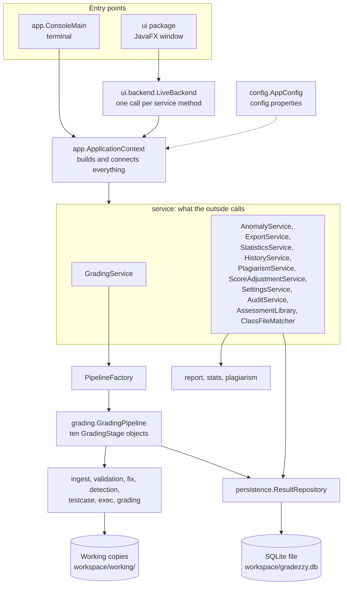
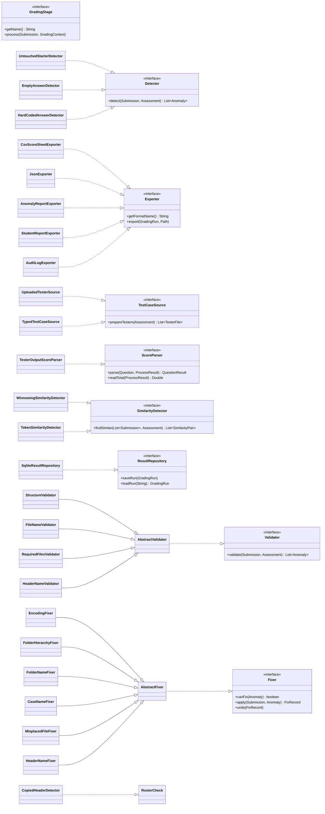
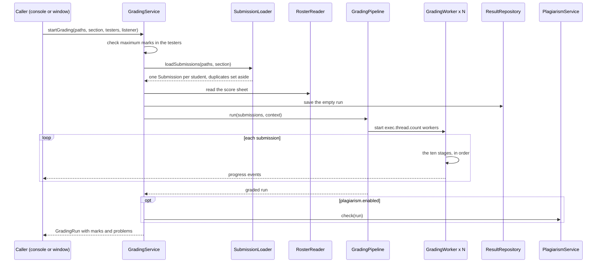
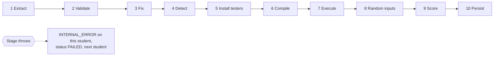
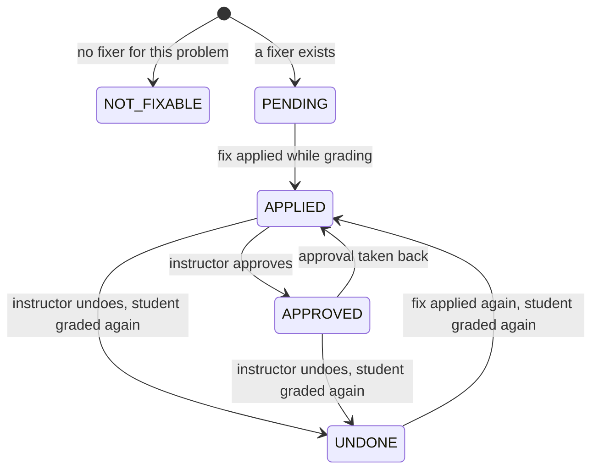
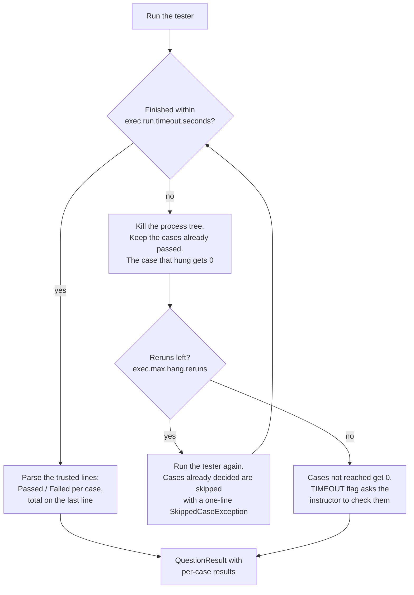
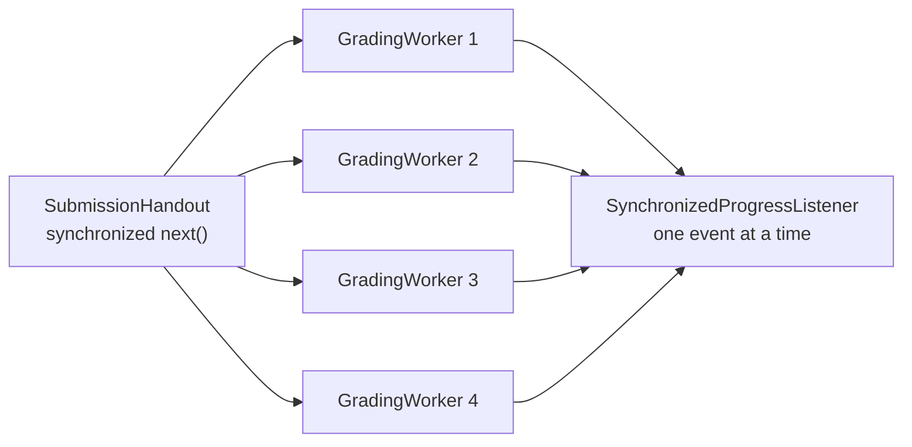
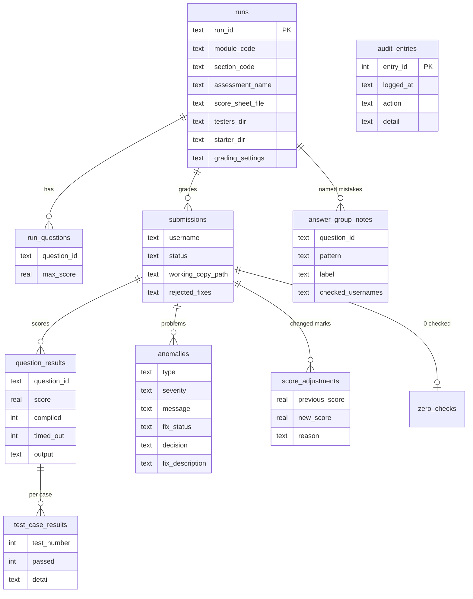

# GradeZZY

**Requires JDK 25 or newer.** GradeZZY does not compile on an older JDK
such as 17 or 21 (`javac` stops with `error: release version 25 not
supported`). Check with `java -version` and `javac -version` before
running `compile.sh` (or `compile.bat`).

GradeZZY marks Java lab tests for you. It was built for CS102 at
Singapore Management University.

You give it three things:

1. the students' zip files,
2. the tester files (the small Java programs that test each answer),
3. the score sheet downloaded from eLearn.

GradeZZY then opens every zip, tidies up common mistakes (a folder with
the wrong name, a file saved in the wrong place), compiles each answer,
runs the testers with a time limit, adds up the marks and fills in the
score sheet, ready to upload back to eLearn. Anything it is unsure
about is shown to you to decide. It never changes the students'
original files.


This README has two parts:

- **Part 1, Using GradeZZY**, is for anyone marking with it. No
  knowledge of the code is needed.
- **Part 2, How it works inside**, is for developers and markers of the
  project. It explains the design, every check and every setting.

## Contents

**Part 1: Using GradeZZY**

- [Words used in this guide](#words-used-in-this-guide)
- [What you need](#what-you-need)
- [Install and open GradeZZY](#install-and-open-gradezzy)
- [Try it without any files](#try-it-without-any-files)
- [Mark a lab test, step by step](#mark-a-lab-test-step-by-step)
- [The other tabs](#the-other-tabs)
- [Marking from the terminal](#marking-from-the-terminal)
- [What GradeZZY checks for you](#what-gradezzy-checks-for-you)
- [How marks are worked out](#how-marks-are-worked-out)
- [Where your files go](#where-your-files-go)
- [Common questions](#common-questions)

**Part 2: How it works inside**

- [Setup and run](#setup-and-run)
  - [What the computer needs](#what-the-computer-needs)
  - [Get the code and the course files](#get-the-code-and-the-course-files)
  - [macOS](#macos)
  - [Windows](#windows)
  - [What each command does](#what-each-command-does)
  - [Running the checks in tests/](#running-the-checks-in-tests)
  - [Troubleshooting](#troubleshooting)
- [Team, ownership and the CS102 syllabus table](#team-ownership-and-the-cs102-syllabus-table)
- [How GradeZZY meets the brief](#how-gradezzy-meets-the-brief)
- [Architecture](#architecture)
- [One grading run, start to finish](#one-grading-run-start-to-finish)
- [The ten pipeline stages](#the-ten-pipeline-stages)
- [Grading several submissions at once](#grading-several-submissions-at-once)
- [Problems the backend reports](#problems-the-backend-reports)
- [After grading: review, corrections and late work](#after-grading-review-corrections-and-late-work)
- [Checks with the model answer](#checks-with-the-model-answer)
- [Answer groups: common mistakes](#answer-groups-common-mistakes)
- [Similar code check](#similar-code-check)
- [Exports](#exports)
- [Statistics](#statistics)
- [Saved state, backup and audit log](#saved-state-backup-and-audit-log)
- [Assessments, modules and sections](#assessments-modules-and-sections)
- [Safety and robustness](#safety-and-robustness)
- [Configuration](#configuration)
- [Libraries](#libraries)
- [How the backend was tested](#how-the-backend-was-tested)

**[AI use](#ai-use)**

# Part 1: Using GradeZZY

## Words used in this guide

| Word | Meaning |
|---|---|
| **Module** | The course, such as `CS102`. |
| **Section** | One class group of a module, such as `G1` or `G2`. You pick it each time you mark, because no file says which section a zip belongs to. |
| **Assessment** | One lab test: its questions, its tester files and its starter files. You set it up once and reuse it for every section. |
| **Submission** | One student's zip file, named after their username, such as `2023-2024-ping.lee.2023.zip`. |
| **Tester file** | A Java program, one per question (`Q1aTester.java`), that runs the student's answer on some test cases. It prints `Passed` or `Failed` for each case and the total mark at the end. |
| **Score sheet** | The CSV file from eLearn that lists the students of a section. GradeZZY reads the class list from it and writes the marks back into it. |
| **Starter files** | The folder the students were given at the start of the test (`RenameToYourUsername`). Used to spot answers the student never changed. Optional. |
| **Model answers** | Your own correct answers, laid out like the starter folder. Used for two extra checks. Optional. |
| **Run** | One round of marking for one section. Every run is saved, so you can come back to it later. |
| **Fix** | A change GradeZZY made to a copy of a submission so it can be marked, such as renaming a folder. You keep or reject each fix. |
| **Flag** | Something GradeZZY wants you to look at, such as code that looks copied. A flag never changes a mark. |

## What you need

### On your computer

- **Java 25 (JDK 25).** Check by typing `java -version` in a terminal.
  It must say 25 or higher. If it does not, install JDK 25 first.
- **Windows (64-bit) or macOS** (Apple Silicon or Intel; the Intel Mac
  version has not been tested yet). Linux is not supported, because its
  JavaFX files are not included.
- Nothing else. Every library is already in the `lib/` folder.

### From the course, for each lab test

| File | Where it comes from | Needed? |
|---|---|---|
| The students' zip files | Downloaded from eLearn. A single bulk download zip, a folder of zips, or folders you unzipped yourself all work. | Yes |
| The tester files | Written by the instructor: one `QxTester.java` per question, plus any data files the testers read (such as `personstester.txt`). | Yes, or type the test cases into GradeZZY instead |
| The score sheet | The section's CSV score sheet exported from eLearn. | Yes |
| The starter folder | The `RenameToYourUsername` folder given to the students. | Optional |
| Model answers | Your own correct answers. | Optional |

A student's zip is expected to look like this (one folder named after
the username, one folder per question inside it):

```text
2023-2024-ping.lee.2023.zip
  ping.lee.2023/
    Q1/  Q1a.java  Q1b.java
    Q2/  Q2a.java  Q2b.java
    Q3/  Q3.java
```

Do not worry if some students got this wrong. GradeZZY fixes the usual
mistakes for you (see [What GradeZZY checks for you](#what-gradezzy-checks-for-you)).

The repository includes the sample testers (`samples/Tester-Files`) and
a made-up section of 42 students to practise on (`samples/e2e`, score
sheet `samples/e2e/roster-G4.csv`). The course's own files (the brief,
the score sheet, the starter folder and the six sample submissions) are
not in the repository; copy them into `samples/` from eLearn if you want
to use them.

## Install and open GradeZZY

Open a terminal **in the `GradeZZY` folder** and type the two commands
for your computer.

**macOS** (Terminal):

```sh
sh compile.sh     # build GradeZZY (once, and again after any code change)
sh run.sh         # open the window
```

**Windows** (Command Prompt):

```bat
compile.bat
run.bat
```

In PowerShell (the default terminal in VS Code), type `.\compile.bat`
and `.\run.bat` instead. Git Bash on Windows can use the `.sh` commands.
Step-by-step JDK set-up for each system, every command and fixes for
common errors are in [Setup and run](#setup-and-run).

`compile` should finish with no errors. The first time the window
opens, it offers a one-minute tour ("New to GradeZZY?"). Take it: it
points at each part of the window. You can take it again at any time
from **Help** (top right).

## Try it without any files

```sh
sh run.sh --demo        # Windows: run.bat --demo
```

This opens the same window filled with made-up students, so you can
click through every step safely without real student data.

## Mark a lab test, step by step

The window has five tabs along the top: **Home**, **Grading**,
**Statistics**, **History** and **Settings**. Marking happens in
**Grading**, which has four steps: **Set up**, **Grade**, **Review** and
**Export**. A step you have not reached yet is greyed out.

Keyboard shortcuts: **Ctrl+Enter** (Cmd+Enter on a Mac) presses the
blue button, **Ctrl+1** to **Ctrl+4** opens a step, **Esc** closes a
window or goes back.

### Before the first section: describe the lab test (once)

Each lab test is an **assessment**. Create it once; every section then
reuses it.

1. On **Home**, click **Manage assessments**, then **New assessment**.
2. Type a **Name**, such as `Lab Test 1`.
3. Under **Files**, choose the **Tester files** folder. GradeZZY reads
   it and fills in the questions and their marks for you.
4. Choose the **Starter files** folder (optional) and the **Model
   answers** folder (optional).
5. Check the **Questions** list: each row is a question id (`Q1a`), the
   folder it lives in (`Q1`) and the file the student writes
   (`Q1a.java`). The maximum mark comes from the tester.
6. Click **Save**. In the list, click **Use** if it is not already
   marked **In use**.


### Step 1: Set up

Choose what you are marking and add the zip files.

1. Under **Class**, pick the **Module**, **Section** and **Assessment**.
2. Under **Submissions**, drag the zip files (or a whole folder) onto
   the box, or click **choose files**. Each file gets a label:
   - **Ready**: it will be marked.
   - **Ready, check note**: it will be marked, but read the note.
   - **Cannot be used**: it is skipped (for example a damaged zip).
     Ask the student for a new copy.
3. Under **Class files**, check that the **Score sheet** and **Tester
   files** say **Ready**. Click **Change** to pick a different score
   sheet. No tester files? Click **or type test cases** to type the
   test cases into GradeZZY instead.
4. Click **Start grading**. GradeZZY shows the questions and marks it
   found and asks you to confirm them.


If **Start grading** is greyed out, the message beside it says why.
Usually a zip file, the score sheet or the tester files is missing.

If this section was marked before, GradeZZY asks whether to **Add to
that run** (useful for late submissions) or **Start a new run**.

### Step 2: Grade

Watch the marks come in. Each student is unzipped, checked, compiled,
tested and saved. A section of 42 students took under a minute on a
recent laptop.

- You can switch tabs, or start another section on Set up; marking
  carries on in the background.
- **Stop grading** pauses it. Students already marked are kept, and
  **Resume** carries on later, even after closing GradeZZY.
- When it finishes, click **Review results**.


### Step 3: Review

Check the results before you export. The table lists every student with
their total and a status, such as **Graded**, **Timed out**, **Q2b did
not compile** or **4 things to check**.

- Use the filters at the top: **Needs a look** shows only the students
  you still have to check.
- Click a student to open their panel on the right. It shows each
  question's mark and which test cases passed.
- **Fixes** GradeZZY made (for example "The folder had the wrong name")
  show what changed. Click **Keep fix** or **Reject fix**. Rejecting
  marks the student again as they submitted it.
- **Flags** (for example "may be hard-coded") are for you to judge.
  Click **Mark as checked** once you have looked. Flags never change a
  mark.
- Click **Adjust** next to a question to change its mark by hand. A
  reason is required, and the change can be undone.
- **Open code** shows the student's file. **Grade this student again**
  re-marks one student.
- The **Errors** view groups students who lost marks the same way (for
  example "Failed test 3"), so you can decide each mistake once. The
  **Similarity** view lists students with very similar code, with
  **Compare** to see them side by side.
- **Keep all N fixes** and **Mark all N flags as checked** at the
  bottom handle everything at once.

When you are happy, click **Continue to export**.


### Step 4: Export

Save the marks.

1. Under **Who to export**, keep **Every student**, or pick **Only the
   students I choose**.
2. Tick any extra files you want: a JSON file with every question and
   test (ticked by default), a list of the problems found, a report on
   each student, the activity log, or the common mistakes.
3. Click **Export score sheet**. The page shows where the files were
   saved, with **Open folder**.

The score sheet is the same file you gave GradeZZY, in exactly the same
format, with each student's total filled in. Upload it to eLearn as it
is. A student who was not marked (nothing submitted, or marking failed)
is left blank so you notice; the page says how many.

Then click **Grade another section** and repeat from Set up.

## The other tabs

- **Home**: one card per section showing how far it has got (Not
  graded, Stopped, N to check, Graded, Exported) and the next thing to
  do. You can drop zip files straight onto a section's card. A
  **Next up** bar at the top suggests what to do next.
- **Statistics**: average, median, spread, pass rate, a chart of the
  marks, each question's pass rate, the tests failed most often and
  the most common compile errors. **Compare sections** puts up to three
  sections side by side.
- **History**: every run ever made. **Open** looks at an old run,
  **Resume** finishes a stopped one, **Restore** makes an earlier run
  the current one. **Backups** saves and restores copies of all results.
  **Activity** lists everything you did, with **Undo**.
- **Settings**: modules and sections, export folders, time limits,
  which checks are on, and more. Type in **Find a setting** to search.
  Click **Save** to apply; changes apply from the next run. Every
  setting is explained in [Configuration](#configuration).
- **Help** (top right): what each tab does, the keyboard shortcuts,
  where files are saved, and the tour.


## Marking from the terminal

You can also mark without the window. This is handy for a quick check.
The terminal prints each student's total and problems, and the similar
code pairs at the end; it does not export files (use the window for
that).

```sh
sh run.sh console              # mark the folder set in config.properties
sh run.sh console G2           # the same, for section G2
sh run.sh console CS102 G2     # the same, for module CS102, section G2
sh run.sh console --testers    # only check how strong each tester is
```

On Windows, use `run.bat` in place of `sh run.sh`. The folders it reads
are the `paths.` settings in `config.properties`, such as
`paths.submissions.dir` for the zip files (see
[Configuration](#configuration)).

Sample output:

```text
GradeZZY console, section CS102 G4
Maximum marks from the testers: Q1a 3.0, Q1b 3.0, Q2a 5.0, Q2b 5.0, Q3 4.0; total 20.0.
Grading 42 submission(s)...
[10/42] fatimah.ali.2024: GRADED, total 20.0, 1 problem(s)
       MISSING_WRAPPER_FOLDER: The question folders were at the top of the ZIP file instead of inside a folder named fatimah.ali.2024.
[21/42] lakshmi.raj.2024: GRADED, total 17.0, 1 problem(s)
       COMPILE_ERROR: Q1b did not compile: Q1b.java:17: error: ';' expected. The other questions were still graded.
```

## What GradeZZY checks for you

Every student is checked in the same order. Problems with one student
never stop the others.

**Fixed for you** (on a copy; you keep or reject each fix on Review):

- the top folder is missing, or not named after the username (for
  example left as `RenameToYourUsername`);
- question folders are one level too deep, or loose files have no
  question folder;
- a file or folder name has the wrong capitals (`q1a.java`), an extra
  ending (`Q1a.java.txt`) or a copy number (`Q1a (1).java`);
- a file sits in the wrong question folder;
- the name and email in the file's header comment are blank (filled in
  from the score sheet);
- a file is saved in an encoding Java cannot read.

**Flagged for you to look at** (marks are never changed):

- an answer is the starter file, unchanged;
- a method still holds only the starter code;
- an answer looks hard-coded to the sample cases;
- a file's header names a different student;
- two students' code is very similar;
- with model answers: an answer gives a different result from the
  model answer on random inputs.

**Reported** (cannot be fixed automatically):

- a damaged or unsafe zip, a missing file, a student not on the score
  sheet, two zips from the same student (the newest is marked), code
  that does not compile, and a tester that crashed or ran too long.

The full list, with the exact names GradeZZY uses, is in
[Problems the backend reports](#problems-the-backend-reports).

## How marks are worked out

- Each question's mark comes from its tester: one test case passed
  earns that case's marks, exactly as the tester's `score += ...`
  lines say. The maximum for each question is read from the tester too.
- Each question is compiled and tested on its own, so a mistake in Q1a
  does not cost marks in Q2.
- A question that does not compile gets 0. The others still count.
- Each tester run has a time limit (10 seconds by default). If a test
  case hangs, GradeZZY stops it, keeps the cases already passed, and
  runs the tester again without the case that hung, so the cases after
  it still earn marks. The student is flagged so you can check.
- Only lines printed by the tester itself are counted. A student who
  prints `Passed` from their own code gains nothing.
- The total is the sum of the question marks. A question can never go
  above its maximum.
- Flags never change a mark. Only you do, with **Adjust** on Review.

## Where your files go

| What | Where (default) |
|---|---|
| Your original zip files | Never changed or moved. |
| Copies GradeZZY unzips and fixes | `workspace/working/` |
| Exported score sheets and reports | `workspace/output/` (each module or section can have its own folder, set in Settings) |
| Saved runs, marks and decisions | `workspace/gradezzy.db` |
| Backups of saved runs | `workspace/backup/` |
| Saved assessments | `workspace/assessments/` |
| All settings | `config.properties` |

Export file names start with the run's id, the module and the section,
such as `RUN-1794379114159-CS102-G4-...`.

## Common questions

**`java` is "not recognized", or GradeZZY will not start.**
Install JDK 25 and open a new terminal. `java -version` must show 25 or
higher.

**PowerShell says the script "is not recognized".**
Put `.\` in front: `.\run.bat`.

**A student got 0. Why?**
Open them on Review. The status and the panel say why: for example the
file did not compile (often a `package` line at the top, which must be
removed), the tester ran too long, the zip could not be opened, or
nothing was submitted. You can **Adjust** the mark if you decide
otherwise.

**A student is "not on the score sheet".**
Usually the zip name has a typo. In the student's panel, click
**Match to ...** to link them to the right row. The marks then go into
that row on export.

**Some submissions came in late.**
Add the late zips on Set up for the same section and choose **Add to
that run**. Students marked before are marked again and the old total
is kept in the activity log.

**GradeZZY was closed while marking.**
Every student is saved as soon as they are marked. Open **Home** or
**History** and click **Resume**.

**Can I mark two sections at the same time?**
Yes. Start one, go back to **Set up**, choose another section and
start it too.

**The window looks broken after `sh compile.sh core`.**
`core` builds only the grading part. Run `sh compile.sh` again before
`sh run.sh`.

**How do I start completely fresh?**
`sh clean.sh` (Windows: `clean.bat`) empties `classes/` and deletes the
`workspace/` folder. **This deletes every saved run, backup and saved
assessment**, so export first.

---

# Part 2: How it works inside

This part is for developers and for marking the project. It starts
with setting GradeZZY up and running it on macOS and Windows, and then
explains the grading backend: everything that runs without the window.
The JavaFX window is a thin layer on top of it, and the terminal entry
point (`sh run.sh console`) drives exactly the same backend. The
window's packages, each teammate's part, the coding rules and the Java
used beyond the CS102 syllabus are in `design/TEAM-GUIDE.md`.

## Setup and run

### What the computer needs

- **JDK 25** (Java Development Kit, not only a runtime), with `java` and
  `javac` on the PATH. `java -version` and `javac -version` must both
  say 25. A plain JDK such as Eclipse Temurin 25 is enough; the team
  used Temurin 25.0.4. A JDK that bundles its own JavaFX is not needed.
- **Nothing else to install.** JavaFX 25.0.4, AtlantaFX, ControlsFX,
  Ikonli and the SQLite driver are already in `lib/` (about 40 MB). See
  [Libraries](#libraries).
- **Windows** (64-bit Intel or AMD) **or macOS** (Apple Silicon or
  Intel). Linux is not supported, because its JavaFX jars are not in
  `lib/`.
- **Git**, to get the code. On Windows, Git for Windows also installs
  Git Bash, which can run the `.sh` scripts.

`lib/` holds one set of JavaFX jars per platform. The scripts choose
the set; you never pick one by hand:

| Folder | Used on | Chosen by |
|---|---|---|
| `lib/javafx/mac-aarch64` | Apple Silicon Mac with an Apple Silicon (aarch64) JDK | `compile.sh`, `run.sh` |
| `lib/javafx/mac` | Intel Mac, or any Mac running an Intel (x64) JDK | `compile.sh`, `run.sh` |
| `lib/javafx/win` | Windows, 64-bit | `compile.bat`, `run.bat`, and the `.sh` scripts in Git Bash |

The other jars in `lib/` (`atlantafx-base`, `controlsfx`, the three
`ikonli` jars and `sqlite-jdbc`) are the same on every platform and are
always on the classpath.

### Get the code and the course files

```sh
git clone https://github.com/damienlaww/GradeZZY.git
cd GradeZZY
```

Run every command below from this `GradeZZY` folder.

`docs/` and most of `samples/` are **not in git**: the course documents
are marked restricted and the samples hold student names. Only
`samples/Tester-Files/` and the synthetic `samples/e2e/` set are
tracked. Copy the rest in from eLearn so the folders look like this,
because `config.properties` points at these paths:

```text
GradeZZY/
  docs/
    CS102-Project-Auto_Grading_System.pdf   the brief
    CS102_Coding_Style.pdf                  the coding style
  samples/
    IS442-ScoreSheet.csv        paths.score.sheet.file
    RenameToYourUsername/       paths.starter.dir (Q1, Q2, Q3 folders)
    student-submission/         paths.submissions.dir (the six zips)
    groundtruth.txt             expected totals, for checking only
    Tester-Files/               in git: paths.testers.dir
    e2e/                        in git: the 42-student test set
```

Without `samples/`, the window still opens (you choose every folder on
Set up), but `run.sh console` has nothing to grade. Nothing in GradeZZY
writes to `samples/` or `docs/`; working copies, exports and the
database go to `workspace/`, which is created on the first run.

### macOS

1. **Install JDK 25** for your processor. On an Apple Silicon Mac (M1
   and later) choose the **aarch64** (ARM64) `.pkg`; on an Intel Mac
   choose the **x64** `.pkg`. The installer puts it in
   `/Library/Java/JavaVirtualMachines/`.
2. **Check it** in Terminal:

   ```sh
   java -version
   javac -version
   java -XshowSettings:properties -version 2>&1 | grep os.arch
   ```

   Both versions must be 25. `os.arch` is what the scripts read to pick
   the JavaFX jars: `aarch64` uses `lib/javafx/mac-aarch64`, anything
   else (`x86_64`) uses `lib/javafx/mac`. An Intel JDK on an Apple
   Silicon Mac also works, through Rosetta, with the Intel jars.
3. **If an older Java comes first**, point the shell at JDK 25 (add the
   two lines to `~/.zshrc` to keep them):

   ```sh
   export JAVA_HOME=$(/usr/libexec/java_home -v 25)
   export PATH="$JAVA_HOME/bin:$PATH"
   ```

4. **Compile and run:**

   ```sh
   sh compile.sh          # compile everything into classes/
   sh run.sh --check      # load every screen once and exit
   sh run.sh console      # grade samples/student-submission in Terminal
   sh run.sh              # open the window
   ```

   The scripts are run with `sh`, so they need no execute permission.
   They are stored as executable in git, so `./run.sh` also works; if it
   says "permission denied" (for example after copying the folder from
   a zip), run `chmod +x compile.sh run.sh clean.sh` once.
5. **If macOS blocks a file** with "cannot be opened because the
   developer cannot be verified" after the project was downloaded as a
   zip through a browser, remove the download flag from the folder once
   and run again:

   ```sh
   xattr -dr com.apple.quarantine .
   ```

   A `git clone` does not set this flag.

On macOS each tester run is placed in `sandbox-exec`, which is part of
macOS, so student code can write only in its own question folder (see
[Execute](#7-execute-running-the-testers-safely)). `run.sh --windowtest`
needs the app that runs `java` (Terminal, or your editor) to be allowed
under System Settings, Privacy and Security, Accessibility and Screen
Recording.

### Windows

1. **Install JDK 25** for x64, for example the Eclipse Temurin 25 `.msi`.
   In the installer, keep "Add to PATH" and also choose "Set JAVA_HOME
   variable". Temurin 25.0.4, for example, installs to
   `C:\Program Files\Eclipse Adoptium\jdk-25.0.4.7-hotspot`.
2. **Set the PATH by hand** if the installer did not: open "Edit the
   system environment variables", then Environment Variables. Set
   `JAVA_HOME` to the JDK folder, and add `%JAVA_HOME%\bin` to `Path`,
   **above** any other Java entry (such as
   `C:\Program Files\Common Files\Oracle\Java\javapath`). Open a new
   terminal afterwards; a terminal that was already open keeps the old
   PATH.
3. **Check it** in a new Command Prompt:

   ```bat
   java -version
   javac -version
   where java
   ```

   Both versions must be 25, and the first line of `where java` must be
   inside the JDK 25 folder.
4. **Compile and run** in **Command Prompt**:

   ```bat
   compile.bat
   run.bat --check
   run.bat console
   run.bat
   ```

   In **PowerShell** (the default terminal of VS Code and Windows
   Terminal), put `.\` in front of each script, or PowerShell says the
   script "is not recognized":

   ```powershell
   .\compile.bat
   .\run.bat --check
   .\run.bat console
   .\run.bat
   ```

   In **Git Bash**, the `.sh` scripts work too and pick
   `lib/javafx/win` themselves:

   ```sh
   sh compile.sh
   sh run.sh --check
   sh run.sh console
   sh run.sh
   ```

Windows has no built-in sandbox for student code, so the console prints
once per run: "Note: student code is not sandboxed, because this system
has no sandbox or java could not start inside it, so it can reach any
file the instructor can." This is expected. The time, memory and output
limits still apply.

### What each command does

On Windows, every `sh x.sh` below is `x.bat` in Command Prompt and
`.\x.bat` in PowerShell, with the same arguments.

| Command | What it does |
|---|---|
| `sh compile.sh` | Empties `classes/`, compiles every source file into it with `javac --release 25`, and copies the stylesheets, fonts and logo pictures the window needs. Prints `Compiled GradeZZY into classes/ using lib/javafx/...`. |
| `sh compile.sh core` | Empties `classes/` and compiles every package except `ui`, with no JavaFX and no jar on the classpath. This proves the backend does not depend on the window. Run `sh compile.sh` again before opening the window. |
| `sh run.sh` | Opens the window. |
| `sh run.sh console` | Grades `paths.submissions.dir` with the score sheet, testers and starter folder in `config.properties`, for the first module and section in the settings, and prints each student's total and problems. Needs no JavaFX. |
| `sh run.sh console G2` | The same, for section G2. |
| `sh run.sh console CS102 G2` | The same, for module CS102, section G2. |
| `sh run.sh console --testers` | Only checks how strong each tester is, with broken copies of the model answer (needs `paths.model.answers.dir`). |
| `sh run.sh --check` | Opens every tab, step and sheet once, live and demo, in both themes and two sizes, off screen, then exits. Use it after a change to the window. |
| `sh run.sh --demo` | The window with synthetic data only. Reads, grades and saves no real files. |
| `sh run.sh --selftest` | Runs the demo flows and prints PASS or FAIL for each. |
| `sh run.sh --snapshot [folder]` | Saves a picture of every screen (default `workspace/ui-snapshots`). |
| `sh run.sh --windowtest [folder]` | Drives the real window with the mouse and keyboard. Leave both alone while it runs. |
| `sh clean.sh` | Empties `classes/` and deletes `workspace/` (working copies, exports, the database and its backups). Run it before zipping the project for submission; the brief requires `classes/` to be empty. |

`run.sh` refuses to start with "Nothing is compiled yet. Run: sh
compile.sh" (`run.bat`: "Run: compile.bat") when `classes/` is empty.
`--demo`, `--selftest`, `--snapshot` and `--windowtest` are developer
checks, described in `design/UI-INTEGRATION.md`.

To use another settings file, start `java` yourself with the options in
`run.sh` plus `-Dgradezzy.config=other.properties`; the scripts always
use `config.properties`.

### Running the checks in tests/

`tests/` holds plain Java programs, one per area, each with a `main`
that prints a line such as `UtilConfigTest: 129 passed, 0 failed` and
exits with 1 when a check fails. There is no test framework.
`tests/README.md` says what each one covers. Compile the project first,
then compile the tests into `build/tests` (ignored by git) and run one by
name. The only difference between systems is the classpath separator:
`:` on macOS, `;` on Windows (Git Bash included).

macOS:

```sh
sh compile.sh
mkdir -p build/tests
javac -encoding UTF-8 -cp "classes:lib/*" -d build/tests tests/*.java
java --enable-native-access=ALL-UNNAMED \
    -cp "classes:lib/*:build/tests" UtilConfigTest
```

Windows, Command Prompt:

```bat
compile.bat
mkdir build\tests
javac -encoding UTF-8 -cp "classes;lib\*" -d build\tests tests\*.java
java --enable-native-access=ALL-UNNAMED -cp "classes;lib\*;build\tests" UtilConfigTest
```

Windows, Git Bash:

```sh
sh compile.sh
mkdir -p build/tests
javac -encoding UTF-8 -cp "classes;lib/*" -d build/tests tests/*.java
java --enable-native-access=ALL-UNNAMED \
    -cp "classes;lib/*;build/tests" UtilConfigTest
```

Replace `UtilConfigTest` with any other `*Test` file name in `tests/`.
In Git Bash, keep the test folder inside the project as above: a
`/tmp/...` path inside a `;` classpath is not translated for the
Windows `java`, which then says "Could not find or load main class".
The tests read `tests/test-config.properties`, never the live
`config.properties`, and use `samples/`, so copy the course files in
first. `clean.sh` does not delete `build/`; delete it by hand when done.

### Troubleshooting

| What you see | Cause and fix |
|---|---|
| `error: release version 25 not supported` while compiling | `javac` is older than 25. Install JDK 25 and put its `bin` first on the PATH (see the steps for your system). |
| `GradeZZY needs JDK 25 or newer; this is JDK 21.` (or another number) | `java` is older than 25, often because another Java comes first on the PATH. On Windows check `where java`; on macOS set `JAVA_HOME` as above. |
| `'compile.bat' is not recognized ...` in PowerShell | Type `.\compile.bat`. PowerShell does not run scripts from the current folder by name. |
| `Nothing is compiled yet. Run: sh compile.sh` | Run the compile script first. `clean.sh` and `clean.bat` empty `classes/`. |
| The window does not start right after `compile.sh core` | `core` leaves out the `ui` package. Run `sh compile.sh` (or `compile.bat`) again. |
| An error that names a `javafx` module or a JavaFX native library | JavaFX was not found or does not match the JDK. Start GradeZZY with `run.sh` or `run.bat`, which add `--module-path lib/javafx/<platform>`; running `java gradezzy.ui.MainApp` by hand leaves JavaFX out. Check that `lib/javafx/` holds `mac`, `mac-aarch64` and `win`, each with four jars. On a Mac, check `os.arch` as in step 2. |
| `No suitable driver found for jdbc:sqlite:...` in a database error | The SQLite driver jar is not on the classpath. Keep `lib/sqlite-jdbc-3.53.4.0.jar` in `lib/` and start with the scripts, which put `lib/*` on the classpath. |
| A warning about a "restricted method" or native access when running `java` yourself | Add `--enable-native-access=ALL-UNNAMED`, as the scripts and the test commands above do. The SQLite driver and JavaFX load native code. |
| `workspace\ could not be removed completely. Close GradeZZY and run clean.bat again.` | GradeZZY is still open and Windows keeps `workspace\gradezzy.db` locked. Close the window, then run `clean.bat` again. |
| `$'\r': command not found` when running a `.sh` script | The script has Windows line endings, which happens when it was copied without git. Get the project with `git clone`; `.gitattributes` keeps the `.sh` files with LF endings. |
| `GradeZZY could not run: The score sheet could not be read: ... does not exist` or `GradeZZY could not run: The submissions could not be read` from `run.sh console` | The course files are not in `samples/`. See [Get the code and the course files](#get-the-code-and-the-course-files). |

## Team, ownership and the CS102 syllabus table

These live in `design/TEAM-GUIDE.md`, so there is one copy of each:

- **Who owns what:** "Who owns what", one row per teammate (Damien,
  Seth, Jun Sheng, Zach, Jing Yuan, Huxley) with the packages they
  built.
- **Java beyond the CS102 syllabus:** the table under "Libraries", with
  one row per untaught construct: where it is used, why, and how to
  explain it. Add new constructs there as a new row.
- **Coding rules and the feature checklist:** the last sections of
  that file.

## How GradeZZY meets the brief

Each requirement of the brief (section 4.1), and where it lives:

| Requirement | How GradeZZY meets it | Main classes |
|---|---|---|
| Batch grading | One call grades every chosen zip, folder or bulk zip, several at a time | `GradingService`, `GradingPipeline` |
| Validate structure, names and required files | Four validators, each returning problems and never throwing | `validation.*` |
| Report anomalies without stopping | Any stage failure becomes an `INTERNAL_ERROR` on that student only; the batch goes on | `GradingPipeline` |
| Correct common errors | Five fixers repair a working copy; each fix can be approved or undone | `fix.*` |
| Stop programs that run too long | Every tester runs in its own process, killed with its child processes at the limit; hung cases are skipped and the tester is run again | `ProcessRunner`, `ExecuteStage` |
| Per-question and per-student scores | Parsed from the tester's own trusted output lines | `TesterOutputScoreParser`, `ScoreCalculator` |
| Export in the provided CSV format | The score sheet is copied byte for byte with only the numerator filled in | `CsvScoreSheetExporter` |

On top of that, the backend also:

- flags untouched starter files, empty answers and hard-coded answers
  for review, without changing a mark;
- finds pairs of students with very similar code;
- reads each question's maximum mark from its tester file;
- generates tester files from test cases typed into the app;
- checks how strong each tester is, by running it on broken copies of
  the model answer;
- calls students' methods with random inputs and edge cases and flags
  answers that differ from the model answer's;
- checks that the score sheet, testers and starter files belong with
  the uploads, and suggests a better file nearby when they do not;
- saves every run to SQLite, so a run can be resumed, retried and
  reviewed after a restart;
- adds a late batch to a section's earlier run;
- lets the instructor change a mark by hand, with a reason, and undo it;
- keeps an audit log of instructor actions;
- writes JSON, a problem report, per-student reports and the audit log;
- works out statistics per module and section;
- keeps several assessments and switches between them.

## Architecture

### Layers



Rules the code keeps:

- **The window holds no grading logic.** Screens call one interface,
  `ui.backend.DashboardBackend`. Its live version passes each call to
  one service method. Every `javafx` import is inside `ui`;
  `compile.sh core` would fail otherwise.
- **One failing submission never stops the batch.** A student's problem
  becomes an anomaly. A stage throws `GradingException` only when the
  stage itself cannot go on, and the pipeline turns that into an
  `INTERNAL_ERROR` on that student alone.
- **Originals are never modified.** Every fix and every tester run
  happens in a working copy under `workspace/working/`.
- **Every setting is external.** `config.properties` is read through
  `AppConfig`, using the names in `ConfigKeys`. Nothing is hard-coded.
- **Storage sits behind an interface.** Only `persistence` contains SQL
  or imports `java.sql`. `SqliteResultRepository` owns the connection
  and every transaction; the package-private table classes beside it
  hold the SQL.

### Packages

| Package | Responsibility | Main classes |
|---|---|---|
| `app` | Entry point and wiring. | `ConsoleMain`, `ApplicationContext`, `ConsoleProgressListener` |
| `config` | Loads and checks `config.properties`; per-module sections and export folders. | `AppConfig`, `ConfigKeys`, `ModuleSections`, `ExportFolders` |
| `model` | Plain data with no logic. | `Submission`, `Student`, `Section`, `Assessment`, `Question`, `QuestionResult`, `TestCaseResult`, `Anomaly`, `GradingRun`, `AuditEntry`, `ScoreAdjustment`, `SavedAssessment`, enums `AnomalyType`, `Severity`, `FixStatus`, `SubmissionStatus` |
| `modelanswer` | Checks that compare with the model answer: tester strength and random inputs. | `ModelAnswerCopy`, `MutantMaker`, `Mutant`, `MutantOutcome`, `TesterStrengthChecker`, `MutantBatch`, `MutantWorker`, `QuestionStrength`, `SignatureReader`, `MethodSignature`, `InputMaker`, `InputDriver`, `CallResult`, `MethodCheck`, `RandomInputChecker`, `RandomInputStage` |
| `ingest` | Turns uploads into submissions, unzips them safely, reads the roster. | `SubmissionLoader`, `ZipExtractor`, `WorkingCopyManager`, `RosterReader` |
| `validation` | One class per structural check. | `Validator`, `AbstractValidator`, `StructureValidator`, `FileNameValidator`, `RequiredFilesValidator`, `HeaderNameValidator`, `ValidationRunner` |
| `fix` | One class per automatic correction, each with apply and undo. | `Fixer`, `AbstractFixer`, `EncodingFixer`, `FolderHierarchyFixer`, `FolderNameFixer`, `CaseNameFixer`, `MisplacedFileFixer`, `HeaderNameFixer`, `FixManager`, `FixRecord` |
| `detection` | Flags suspicious answers. Never changes a mark. | `Detector`, `UntouchedStarterDetector`, `EmptyAnswerDetector`, `HardCodedAnswerDetector`, `RosterCheck`, `CopiedHeaderDetector` |
| `testcase` | Where testers come from, their maximum marks, and the per-question folders. | `TestCaseSource`, `UploadedTesterSource`, `TypedTestCaseSource`, `TesterGenerator`, `TesterInstaller`, `TesterMarks`, `QuestionWorkspace`, `FolderSnapshot` |
| `exec` | Runs `javac` and `java` as separate processes with limits. | `ProcessRunner`, `SourceCompiler`, `TesterRunner`, `TesterHarness`, `TrustedPrintStream`, `JdkCommand`, `RunningProcesses`, `HarnessWatchdog` |
| `grading` | The pipeline, its stages, scoring and parallel workers. | `GradingPipeline`, `GradingStage`, the nine `...Stage` classes, `ScoreParser`, `TesterOutputScoreParser`, `ScoreCalculator`, `GradingWorker`, `SubmissionHandout`, `CancellationToken`, `QuestionRerunner` |
| `plagiarism` | Compares students' code. | `SimilarityDetector`, `WinnowingSimilarityDetector`, `TokenSimilarityDetector`, `Winnowing`, `Fingerprint`, `JavaTokenizer`, `JavaToken`, `SimilarityPair`, `LineComparison`, `LineKind` |
| `report` | One class per export format. | `Exporter`, `CsvScoreSheetExporter`, `JsonExporter`, `JsonWriter`, `AnomalyReportExporter`, `StudentReportExporter`, `AuditLogExporter` |
| `stats` | Statistics over runs. | `StatisticsCalculator`, `StatisticsSummary`, `StatisticsFilter`, `MarkBand` |
| `persistence` | Saves, loads and backs up grading state. | `ResultRepository`, `SqliteResultRepository`, `SqliteSchema`, `RunTables`, `SubmissionTables`, `ReviewTables`, `AdjustmentTable`, `AuditTable`, `JdbcSupport`, `BackupManager` |
| `service` | Everything the console and the window call. | `GradingService`, `PipelineFactory`, `AnomalyService`, `ExportService`, `StatisticsService`, `HistoryService`, `PlagiarismService`, `ScoreAdjustmentService`, `SettingsService`, `AuditService`, `AssessmentFactory`, `AssessmentLibrary`, `ClassFileMatcher`, `ServiceRegistry` |
| `util` | Shared helpers. | `FileUtils`, `TextUtils`, `InputValidator` |

### Extension points

Each kind of plug-in is an interface with exactly one place where
implementations are registered. Adding a check, a fix, an export format
or a stage means writing one class and adding one line.



The method lists are shortened; see each interface for the exact
signatures.

| Interface | Registered in |
|---|---|
| `GradingStage` | `PipelineFactory.createPipeline` (order matters) |
| `Validator` | `PipelineFactory.createValidationRunner` |
| `Detector` | `PipelineFactory.createDetectors` (each one can be switched off) |
| `RosterCheck` | `PipelineFactory.createRosterChecks` (a detector that also reads the score sheet) |
| `Fixer` | `ApplicationContext.createFixManager` (run in the order added) |
| `Exporter` | `ApplicationContext.createExportService` |
| `TestCaseSource` | passed to `GradingService.startGrading` |
| `ScoreParser`, `SimilarityDetector`, `ResultRepository` | `ApplicationContext` |

## One grading run, start to finish



`GradingService.startGrading` refuses to start, with a message, only
when the whole batch cannot be graded: grading is already running, the
module or section is not in the settings, the score sheet, uploads or
testers cannot be read, or a tester's maximum mark cannot be counted.
A problem with one student never stops it.

## The ten pipeline stages



| # | Stage | What it does | Problems it can add |
|---|---|---|---|
| 1 | `ExtractStage` | Unzips into a working copy and matches the student on the roster. | `INVALID_ARCHIVE`, `UNKNOWN_STUDENT` |
| 2 | `ValidateStage` | Runs every validator. | `MISSING_WRAPPER_FOLDER`, `WRONG_FOLDER_NAME`, `MISSING_QUESTION_FOLDER`, `MISSING_FILE`, `WRONG_FILE_NAME`, `MISSING_HEADER_NAME` |
| 3 | `FixStage` | Checks encodings, applies fixes, then validates again. | `WRONG_ENCODING` |
| 4 | `DetectStage` | Runs every detector that is switched on, then each roster check, which also reads the run's score sheet. | `UNTOUCHED_STARTER`, `EMPTY_ANSWER`, `HARD_CODED_ANSWER`, `COPIED_HEADER` |
| 5 | `InstallTestersStage` | Copies testers, data files and provided class files in. | `MISSING_FILE` |
| 6 | `CompileStage` | Compiles each question in its own folder. | `COMPILE_ERROR` |
| 7 | `ExecuteStage` | Runs each tester with limits and parses its output. | `TIMEOUT`, `RUNTIME_ERROR` |
| 8 | `RandomInputStage` | Calls the student's methods with random inputs and compares with the model answer. Added only when `random.inputs.enabled` is true and `paths.model.answers.dir` is set. | `DIFFERENT_FROM_MODEL_ANSWER` |
| 9 | `ScoreStage` | Caps each question at its maximum and adds up the total. | |
| 10 | `PersistStage` | Saves the student's result to SQLite. | |

A `CancellationToken` is checked between stages, so Cancel stops each
student at its next step and the run can be resumed later.

### 1. Extract: reading the uploads

`SubmissionLoader` accepts any mix of zips, folders of zips, folders
unzipped by hand and bulk zips downloaded from eLearn.

- **Username.** Taken from the zip name after removing the prefix in
  `ingest.zip.name.prefix.pattern` (so `2023-2024-ping.lee.2023.zip`
  gives `ping.lee.2023`), any browser copy number such as ` (1)` and
  the ` - Copy` or ` - Copy (2)` Windows adds to a copied file, in lower
  case (`2023-2024-PING.LEE.2023.ZIP` also gives `ping.lee.2023`). Every
  `.zip` ending goes, so `2023-2024-ping.lee.2023.zip.zip` gives the
  same username. A graded file with a Windows copy name gets a
  `DUPLICATE_SUBMISSION` note.
- **Bulk zips.** A zip that holds student zips, and no question folder,
  is unpacked into `workspace/working/.batch-*` and each zip inside is
  one student.
- **Duplicates.** One file per username is graded: the newest
  download, which has the highest copy number (` - Copy` counts as 1);
  a file without one is the oldest. Two zips of the same name in
  different folders of a bulk zip are told apart by the time the bulk
  zip records for each: the newer is graded, and on a tie the first by
  path. The others are named in a `DUPLICATE_SUBMISSION` warning, which
  says which folder of the bulk zip each one was in.
- **Folders unzipped by hand.** A chosen folder holding a question
  folder is one student, and so is each sub-folder that holds one
  directly, inside its only sub-folder, or at the end of a chain of
  folders that each hold only one folder (`s06/s06/s06/Q1`).
- **Skipped.** `.DS_Store`, `__MACOSX`, `Thumbs.db`, the starter folder
  itself, and files that are not zips.

`ZipExtractor` unzips with `java.util.zip` and refuses unsafe entries:
names with `..` or absolute paths (zip slip), names Windows cannot
create, more than `ingest.max.zip.entries` entries or more than
`ingest.max.zip.size.mb` unzipped. A folder or file name that ends with
a space or a dot (`ping.lee.2023 /`), which Windows cannot save, is
unpacked without them and named in an `INVALID_ARCHIVE` warning; two
names that become one stop the zip. A damaged or empty zip becomes
`INVALID_ARCHIVE` for that student only. `WorkingCopyManager` removes the
student's own `.class` files, except the provided ones listed in
`assessment.provided.class.files`. `RosterReader` reads the eLearn score
sheet, removing the `#` in front of the id and username and the spaces
around them (`#ping.lee.2023 ` and `# ping.lee.2023` both give
`ping.lee.2023`), and accepts the same sheet re-saved by Excel (byte
order mark, LF endings, rows of empty cells such as `,,,,,,,`, which are
skipped).

### 2. Validate: checking the structure

| Validator | Checks | Reports |
|---|---|---|
| `StructureValidator` | One top folder named after the username, holding one folder per question group. | `MISSING_WRAPPER_FOLDER`, `WRONG_FOLDER_NAME` (a starter name such as `RenameToYourUsername` is called out), `MISSING_QUESTION_FOLDER` |
| `FileNameValidator` | A file whose name matches a required name only when case is ignored (`q1a.java`), has an ending added (Notepad's `Q2a.java.txt`) or a browser's copy number (`Q1a (1).java`). Java needs the exact name. | `WRONG_FILE_NAME` |
| `RequiredFilesValidator` | Every file in `assessment.question.<id>.file` is present, and every other source file of the question. | `MISSING_FILE` |
| `HeaderNameValidator` | The first `validation.header.scan.lines` lines of each required file hold a name after `Name:` and an email after `Email ID:` (spaces before the colon, as in `Name :`, are accepted). | `MISSING_HEADER_NAME` |

Each problem is reported once: a misnamed file is not also reported as
missing, and the files of a missing folder are not reported one by one.

**Which folder is graded.** One rule, `util.AnswerFolderRule`, picks the
folder that holds the question folders, for the checks, the fixes and
grading (`QuestionFolderFinder`) alike. Every place that holds question
folders counts: the top of the zip, and inside each top folder the
folder itself when it holds them directly, and each extra folder that
leads to them (`src` in an IntelliJ project, a chain of folders that
each hold only one folder, such as `Users/jy/Desktop/ping.lee.2023` from
a command-line zip, or any other folder such as `backup`). `out`, `bin`,
`__MACOSX` and hidden folders never count, and when there are several
places, one whose question folders hold no `.java` file (a stray `Q1`
with notes in it) is dropped. When more than one place is left, as with
`ping.lee.2023/` and `ping.lee.2023 (2)/`, a starter folder with work
in it beside the username folder, `alice/Q1` beside `alice/src/Q1`, or
`alice/backup/Q1` beside `alice/Q1`, GradeZZY does not guess: one
`MISSING_QUESTION_FOLDER` error names the folders, and every question
gets 0 until the student says which is their answer.

A question's other source files are the starter's other `.java` files in
its folder, such as `GoldMember.java` next to `Q3.java`
(`Question.getExtraFileNames`, read from the run's starter folder by
`AssessmentFolderScanner.fillExtraFiles` before every grading). The file
checks, the hard-coded answer check and the similar code check read
them as well as the answer file.

### 3. Fix: correcting the working copy

`FixManager` offers each problem to the fixers in this order, so folders
are in place before names and headers are touched:

| Fixer | Fixes | How |
|---|---|---|
| `EncodingFixer` | `WRONG_ENCODING` | Backs the file up, removes a UTF-8 byte order mark, rewrites a UTF-16 file (Notepad's "Unicode", found by its byte order mark) as UTF-8, and rewrites a file that is not UTF-8 (read as Windows-1252) as UTF-8. |
| `FolderHierarchyFixer` | `MISSING_WRAPPER_FOLDER`, `MISSING_QUESTION_FOLDER` | Moves the question folders into a new username folder, or up out of an extra folder or a chain of single folders (`Users/jy/Desktop/ping.lee.2023`), removing the folders left empty. Moves a question folder dragged into itself (`Q1/Q1`) up one level. When the answer files lie loose in the username folder with no question folders, makes those folders and moves each question's files into its own. |
| `FolderNameFixer` | `WRONG_FOLDER_NAME` | Renames the only top folder to the username. |
| `CaseNameFixer` | `WRONG_FILE_NAME`, `MISSING_QUESTION_FOLDER` | Renames `q3` to `Q3`, `q1a.java` to `Q1a.java`, `Q2a.java.txt` or `Q2a (1).java` to `Q2a.java`, through a temporary name because Windows and macOS ignore case. |
| `MisplacedFileFixer` | `MISSING_FILE` | Moves a required file found in exactly one other question folder, such as `Q2/Q1a.java`, into its own folder. Found in none or in two, it is left for the instructor. |
| `HeaderNameFixer` | `MISSING_HEADER_NAME` | Writes the roster name and email after the blank labels, keeping the file's own encoding. |

After a fix that moved or renamed something, `FixStage` runs the file
checks again on the new layout and fixes only what is new, and copies
the provided class files into any question folder a fix made. A fix that
cannot be made leaves the problem for the instructor, with the reason.
Setting `fix.auto.apply.enabled=false` reports problems without fixing.

Every fix is recorded in a `FixRecord` and can be undone. A file whose
content changes is first copied into the hidden `.gradezzy-backup`
folder of the working copy; a move or rename is undone by moving back.



### 4. Detect: flags for review

Detectors only add a flag. **They never change a mark.**

| Detector | Flags | Rule |
|---|---|---|
| `UntouchedStarterDetector` | `UNTOUCHED_STARTER` | A file equal to the starter file once the header comment, blank lines and line endings are ignored. If every file is untouched, one flag says the original resource folder was submitted. |
| `EmptyAnswerDetector` | `EMPTY_ANSWER` | An answer method whose body, without comments and spaces, is still the starter's body. Every overload is checked. |
| `HardCodedAnswerDetector` | `HARD_CODED_ANSWER` | A method with 2 or more `if` or `case` branches comparing a value with a fixed literal, such as `s.equals("cat")`. Common values (0, 1, -1), separators and numbers inside a calculation do not count. |
| `CopiedHeaderDetector` | `COPIED_HEADER` | A file header whose `Email ID:` gives another username (one with a dot, so a student number does not count), or whose `Name:` is another student on the score sheet, first or last name first. One flag per student, naming the files and the other student. When the student is not on the score sheet but the header names someone who is, it says the zip name may be wrong. |

The starter folder is the one chosen for the batch, or
`paths.starter.dir`. A detector that fails adds a warning that it could
not run; it never fails the student.

### 5. Install testers

`TestCaseSource` supplies one tester per question:

- `UploadedTesterSource` matches `Q1aTester.java` and so on in the
  tester folder to the questions (`<id>` plus
  `grading.tester.class.suffix`).
- `TypedTestCaseSource` turns test cases typed in by the instructor into
  tester source with `TesterGenerator`. The generated tester extends the
  student's class and prints exactly what the provided testers print,
  one mark per case. Generated files are kept in
  `workspace/output/generated-testers`.

**Maximum marks come from the testers, not from a setting.**
`TesterMarks` adds up the `score += <number>` lines of each tester,
ignoring comments and text in quotes, which gives 3, 3, 5, 5 and 4 for
the provided testers. A tester that changes the score in a way that
cannot be counted (`score++`, `score += MARK`, `score +=` inside a loop)
stops grading with the reason, rather than giving a wrong maximum. The
total is compared with the score sheet's denominator, and a mismatch is
reported.

`TesterInstaller` copies each tester into its question folder, with the
data files in `assessment.tester.data.files`. The student's own copies
of those data files are replaced, so an edited data file cannot change
a mark.

### 6. Compile

Each question is compiled in its own copy of its folder,
`<working copy>/.questions/<id>/` (`QuestionWorkspace`), so code run for
Q1a cannot change Q1b's tester. A question that does not compile gets
`COMPILE_ERROR` with the first compiler message and a 0, and the other
questions are still compiled and graded. A compile that misses
`exec.compile.timeout.seconds` is tried once more, because a busy
computer can slow `javac`. After a second miss the student is left for
Retry with no mark taken. `FolderSnapshot` then remembers the compiled
classes and data files of each question folder. A file that starts with
a `package` line does not compile with its tester (`javac` says
`duplicate class`); the message names the package line as the cause and
says it must be removed, and the mark stays 0. `javac` always writes its
messages in English (`-J-Duser.language=en -J-Duser.country=US`), so
they read the same, and group the same in Statistics, on every computer.

### 7. Execute: running the testers safely

This is the stage that keeps one bad program from blocking the batch.

**One tester, one process.** `ProcessRunner` starts `java` with
`ProcessBuilder` and reads both of its output pipes in a loop, pausing
50 ms only when neither has output waiting, so the program never
freezes on a full output buffer and a program that prints a lot is not
slowed down; it stops keeping output at
`exec.max.output.characters`. At `exec.run.timeout.seconds` it kills the
process and every child process it started. A shutdown hook
(`RunningProcesses`) kills any tester still running if GradeZZY itself
closes or crashes, and a watchdog thread inside each tester run
(`HarnessWatchdog`) ends the run on its own if GradeZZY is gone.

**Limits on student code.** Each run gets `exec.max.memory.mb` of heap,
a 2 MB thread stack and one CPU, only the core Java module
(`--limit-modules=java.base`) and no native code. On macOS the run is
also placed in `sandbox-exec`, so it can write only in its own question
folder and cannot read other students' working copies. Other systems
have no built-in sandbox, and the console says so once per run. When
`exec.java.command` is the bare word `java` (or `exec.javac.command` is
`javac`), the program of the JDK running GradeZZY is used, not whatever
`java` comes first on the PATH (`JdkCommand`). Before the first run,
`TesterRunner` runs that `java` once with every tester option plus
`-version`; if it fails, as an older JDK does on
`--illegal-native-access`, each student stops with an `INTERNAL_ERROR`
naming the reason instead of getting 0. Testers run in English
(`-Duser.language=en -Duser.country=US`).

**Only the tester's own lines are believed.** A student who prints
`Passed` gains nothing:

- The tester is started inside `TesterHarness`, which receives a secret
  token on standard input and replaces standard output with
  `TrustedPrintStream`.
- A line is marked with the token only when the tester printed it with
  no student method on the call stack (checked with `StackWalker`).
  Every other line is prefixed as student output, and
  `TesterOutputScoreParser` never counts it.
- Every `print`, `println` and `printf` of the tester is marked,
  whatever it prints (a `double`, an `int`, text, or a boxed number
  such as `Double`; any other object is not, since its `toString` may
  be student code). Text printed with `print` is marked once its line
  ends, or when the tester stops.
- A marked line longer than 1000 characters, such as a huge wrong
  answer the tester echoes, is cut, so the tester's later lines always
  fit in the output limit.
- A case header is `grading.test.header.marker` followed by a number
  (`Test 1: ...`, `Test1:`), so a banner such as `Testing compress` is
  not a case. A pass is a line that starts with `grading.pass.marker`
  (`Passed`, `Passed!`); the fail marker is checked first.

**Tampering is undone.** Before each tester run, `ExecuteStage` puts
back any compiled class or data file that changed since compiling, and
flags it, so code run for one question cannot change another's result.

**A hanging test case does not cost the cases after it.** The brief asks
for the instructor's manual routine to be automated: stop the tester,
remove the case that hangs, run the rest. `ExecuteStage` does exactly
that:



What each kind of early end does:

- **Timeout.** Each timeout adds a `TIMEOUT` problem saying which cases
  passed, which hung and which were never reached.
- **Exception inside a case.** The tester prints it and the case
  counts as failed.
- **Crash.** An error the tester cannot catch, such as a
  `StackOverflowError`, or static code in the student's class that
  throws while it loads, ends the whole run (exit code
  `TesterHarness.CRASH_EXIT_CODE`, after a marked line only the harness
  can print). That case is skipped and the tester run again, like a
  hang, and a `RUNTIME_ERROR` says so.
- **`System.exit`.** A student's own `System.exit`, with any code
  including 3, is not run again. A run that ends early never prints the
  tester's total, so its `RUNTIME_ERROR` asks the instructor to read
  the output before accepting the passes.
- **Header printed outside `try`.** A tester that prints a case's
  header before the case's `try` block cannot skip that case: the skip
  stops the whole run, and the message says that case and the ones
  after it were not run and need checking by hand.

**Each case earns its own marks.** In short, a mark is only ever
backed by a `Passed` line the tester printed itself:

- **No total printed.** A run that timed out, crashed or ended early
  never printed its total, and a last line that is not a number cannot
  be read. So each passed case earns what its own `score += <number>;`
  line in the tester gives (`TesterMarks.readCaseMarks`): a case worth
  0.5 counts as 0.5 and one worth 2 as 2.
- **Skipped cases.** A skipped case never earns marks, even when a
  tester that expects an exception catches the skip and prints
  `Passed`.
- **Total checked against the cases.** A finished run's printed total
  is kept only if it is not more than its passed cases earn, so a total
  that no case's verdict backs is never believed: student code can hide
  the tester's lines and set its score field by reflection. A total
  above what the passed cases earn is replaced by their marks and
  flagged.
- **No verdicts at all.** When no case printed a verdict, no case
  passed, so the question gets 0. The run's "not fully recognised" flag
  says that the printed total could not be checked against any verdict,
  and that a tester which words its verdicts differently needs its
  "Passed line" and "Failed line" set in Settings
  (`grading.pass.marker`, `grading.fail.marker`).
- **Above the maximum.** A total above the question's maximum is cut to
  it and flagged, because the maximum read from the tester may be wrong
  (for example a `score += 0.5` inside a helper called once per case).
- **Cases that cannot be matched.** When the cases of a run with no
  total (unfinished, or whose last line is not a number) cannot be
  matched one for one to the tester's score lines, each pass gets the
  smallest mark a case is worth, and a `RUNTIME_ERROR` says so.
- **Output not recognised.** A run that ends normally but whose last
  line is not a total, that printed no case, or whose cases have no
  verdict (as when student code replaces `System.out`, or the tester
  words its verdicts differently) gets a `RUNTIME_ERROR` saying the
  output was not fully recognised, so missing marks are checked by
  hand.

None of these flags changes a mark by itself.

### 8. Score and 9. Persist

`ScoreCalculator` sets each question's mark and never lets it exceed the
question's maximum; the student's total is the sum. `PersistStage` saves
the student to SQLite straight away, so a crash or Cancel loses at most
the students still being graded.

## Grading several submissions at once

`GradingPipeline` grades `exec.thread.count` submissions at the same
time, using only `Thread`, `Runnable` and `synchronized`:



Each submission has its own working copy and writes only to its own
`Submission` object, so workers never share student data. The only
shared state (the next submission to hand out, the progress listener,
`FixManager` and the repository) is guarded by `synchronized`. Each
worker calls the same `gradeSafely` method as the single-threaded path,
so both give the same marks.

## Problems the backend reports

Every problem is an `Anomaly` with a type, a severity (`INFO`,
`WARNING` or `ERROR`), a message written for the instructor, a suggested
action and a fix status.

| Type | Meaning | Raised by | Fixed automatically |
|---|---|---|---|
| `MISSING_WRAPPER_FOLDER` | Question folders at the top of the zip, with no username folder | `StructureValidator` | Yes |
| `WRONG_FOLDER_NAME` | Top folder not named after the username | `StructureValidator` | Yes |
| `MISSING_QUESTION_FOLDER` | A question folder is missing, too deep, or GradeZZY cannot tell which of several folders to grade | `StructureValidator` | When it is too deep (an extra folder, a chain of single folders, or inside itself) or wrongly cased |
| `MISSING_FILE` | A required file or a tester is missing | `RequiredFilesValidator`, `TesterInstaller` | No |
| `WRONG_FILE_NAME` | File name differs only in letter case, has an ending added or a browser's copy number | `FileNameValidator` | Yes |
| `MISSING_HEADER_NAME` | Blank name or email in the header | `HeaderNameValidator` | Yes, from the roster |
| `WRONG_ENCODING` | Byte order mark or not UTF-8, which `javac` rejects | `FixStage` | Yes |
| `UNKNOWN_STUDENT` | Not on the score sheet | `ExtractStage` | No |
| `INVALID_ARCHIVE` | Not a readable or safe zip | `SubmissionLoader`, `ExtractStage` | No |
| `DUPLICATE_SUBMISSION` | Another upload with the same username was set aside | `SubmissionLoader` | No |
| `COMPILE_ERROR` | A question did not compile | `CompileStage` | No |
| `TIMEOUT` | A tester was stopped at the time limit | `ExecuteStage` | No |
| `RUNTIME_ERROR` | A tester ended with an error, or its output could not be fully read | `ExecuteStage` | No |
| `UNTOUCHED_STARTER` | A file equals the starter file | `UntouchedStarterDetector` | Flag only |
| `EMPTY_ANSWER` | A method still holds only the starter code | `EmptyAnswerDetector` | Flag only |
| `HARD_CODED_ANSWER` | An answer looks hard-coded to sample cases | `HardCodedAnswerDetector` | Flag only |
| `COPIED_HEADER` | A file header names another student | `CopiedHeaderDetector` | Flag only |
| `SIMILAR_CODE` | Code very similar to another student's | `PlagiarismService` | Flag only |
| `DIFFERENT_FROM_MODEL_ANSWER` | Some random inputs give a different answer from the model answer's | `RandomInputStage` | Flag only |
| `INTERNAL_ERROR` | GradeZZY itself failed on this student | `GradingPipeline` and the stages | No |

For example, on the six provided samples the console reports:

```text
[3/6] chee.teo.2022: GRADED, total 12.0, 3 problem(s)
       MISSING_WRAPPER_FOLDER: The question folders were at the top of the
       ZIP file instead of inside a chee.teo.2022 folder.
       MISSING_HEADER_NAME: Q3/Q3.java has no name after Name: and no
       email after Email ID: in its header.
       UNTOUCHED_STARTER: Q3/Q3.java is unchanged from the starter file.
```

## After grading: review, corrections and late work

| Action | Method | What happens |
|---|---|---|
| Approve a fix | `AnomalyService.approveFix`, `approveAll` | The fix is kept and marked `APPROVED`. |
| Undo a fix | `AnomalyService.undoFix`, `undoAll` | The working copy is put back and the student is graded again without the fix, so the mark matches the files as submitted. The undone fix is remembered, so Retry and Resume skip it too, even after a restart. |
| Apply a fix again | `AnomalyService.reapplyFix` | The fix is made again and the student regraded. |
| Record a review decision | `AnomalyService.saveDecision`, `saveZeroCheck` | Saved with the run, so it is there after a restart. |
| Change a mark | `ScoreAdjustmentService.adjust`, `undo` | A mark from 0 to the question's maximum, with a required reason. Saved, shown in exports and the audit log. Only the newest change of a question can be undone. |
| Run one question again | `QuestionRerunner` | Runs one tester for one student to look at the output; the saved marks do not change. |
| Grade one student again | `GradingService.regradeSubmission` | Runs the pipeline for that student and replaces the result. From Review ("Grade this student again"), marks set by hand are put back (`ScoreAdjustmentService.keepAfterRegrade`) and the activity log keeps the old and new totals. Fixes are made again and wait for Keep. |
| Grade one question again | `GradingService.regradeQuestion` | Adds, compiles and runs only that question's tester in the student's working copy (`PipelineFactory.createQuestionPipeline`), then replaces only that question's result and its compile or tester problems. Other marks, fixes, flags and decisions stay; a mark set by hand is kept. A step that fails adds an error to the student and keeps the old mark. |
| Grade ticked students again | `ui.flow.RegradeJob`, `GradingService.regradeSubmission` | Review's "Grade N ticked students again": one confirm, one background job with a progress bar, then a summary of whose totals changed. A refused upload stays refused and a mark set by hand is kept; the summary names both. Each student gets a line in the activity log. |
| Cancel | `GradingService.cancel(Section)` | Each student of that section's batch stops at its next stage; finished students are saved, and other sections keep grading. |
| Retry failed | `GradingService.retryFailed` | Grades only the students that failed or were not finished, for any run started, resumed or added to in this session (`canRetry`). |
| Resume | `GradingService.resume` | Loads a saved run, with its own score sheet, tester and starter folders, and grades what is left. |
| Late batch | `GradingService.findNewestRun`, `addToRun` | Adds students to the section's earlier run. A student graded before is graded again and the old total is kept in the audit log. Refused when the tester folder or score sheet is not the run's. |
| Change score sheet | `GradingService.changeScoreSheet` | Matches the students to another sheet and saves the run, without grading again. |
| Match a student to the score sheet | `GradingService.matchStudent`, `StudentMatcher` | For an upload not on the score sheet, such as `tina.goh.2052` for `tina.goh.2025`: the student panel suggests the closest student with no submission when the names differ by a typo (at most two letters changed, added, removed or swapped) and lists the rest closest first. The match is saved with the run, kept when the student is graded again or the score sheet changes, fills that student's row in the CSV export, and can be undone. |

### Grading several sections at once

Several sections can be graded at the same time, each with its own
batch. `GradingService` keeps an `ActiveGrading` for each grading that
runs (batch, retry, resume, late batch or grading again): its section,
its own `CancellationToken` and the students it grades. Each run keeps
its loaded testers and roster by id, so Retry, Resume and late batches
work for any run of the session, and run ids stay unique when two start
in the same millisecond. It refuses:

- a second grading of a section that is being graded, as both would
  change the same run; and
- a batch that holds a student another running batch holds, as both
  would write the same working copy (`paths.working.dir/<username>`).

In the window, each batch is a `GradingJob` that keeps its own progress.
Set up stays usable while grading, so another section can be chosen and
started; Grade shows the batch of the section on screen, with its own
Cancel; Home's cards show "Grading 12 of 65" for every section being
graded; and a batch of another section that ends says so in a notice
with a link to it, without taking the screen away. Switching the
assessment waits until every section has finished, because grading
reads the assessment's folders from the settings, and so do backups and
restores, which would mix a batch into other results.

Measured on Lab Test 2's 65 students: graded as one batch in 82 s, and
as two sections of 30 and 35 at once in 65 s, with the same total and
status for every student.

## Checks with the model answer

Two checks use the model answers in `paths.model.answers.dir`, a folder
laid out like the starter folder (`Q1/Q1.java`, `Q3/GoldMember.java` and
so on). Each lab test has its own answers, so the folder is part of each
saved assessment: it is chosen in the assessment editor ("Model
answers", beside the tester and starter folders), and choosing an
assessment copies it into the setting. With the setting empty, neither
check runs. Both compile and run with
the same `javac`, sandbox and limits as grading, in folders of their own
under `paths.working.dir` that are deleted afterwards, and neither
changes a mark.

### Tester strength: breaking the model answer on purpose

A weak tester gives wrong marks to a whole class. Before grading,
GradeZZY makes broken copies of each question's model answer and runs
the tester on each. In the window, Set up runs it on a background
thread once the tester folder check finds nothing wrong
(`tester.strength.enabled`), or when "Check how strong each tester is"
is clicked on the tester row with the setting off; the row then sums up
the result and "See details" lists each question and the broken copies
its tester missed (`TesterStrengthCheck`, `TesterStrengthSheet`). The
console runs it before grading (`tester.strength.enabled`), or on its
own with `run.sh console --testers`:

1. `MutantMaker` splits the model answer into tokens with
   `JavaTokenizer.tokenize` and applies standard mutation rules: `<` and
   `<=` swapped (and the same for `>`), `==` and `!=`, `&&` and `||`, `+`
   and `-`, `*` and `/`, `++` and `--`, `true` and `false`, a whole
   number made one larger, an `if` condition reversed, and a statement
   removed (a `return`, `break`, assignment, `count++` or method call).
2. Only lines the student had to write are changed. A line that is also
   in the starter file, and the `main` method, which testers never call,
   are left alone. The `<` and `>` of types such as `ArrayList<Integer>`
   are not comparisons and are skipped. When there are more places than
   `tester.strength.max.copies`, copies are taken evenly from the whole
   answer.
3. `TesterStrengthChecker` first runs the tester on the model answer
   itself. If that is not full marks, the question is reported and no
   copy is made, since the tester or the model answer needs a look
   first.
4. Each copy is compiled with the tester and run with
   `tester.strength.timeout.seconds`, on `exec.thread.count` threads
   (`MutantWorker`, `MutantBatch`). A copy that does not compile is left
   out. A copy that loses marks, or runs past the limit, is caught. A
   copy that still gets full marks survives. The summary says how many
   were caught only by the time limit, since a slow or busy computer can
   stop a copy that would have survived.
5. The result per question is the mutation score: the share of copies
   caught. Every surviving copy is listed with its line and change, and
   the report is saved as `tester-strength.txt` in the section's export
   folder.

On Lab Test 3 (a 45-student set kept outside git, so it is not in every
copy of `samples/`) it takes about 20 seconds with 4 threads and finds,
for example:

```text
Q5: the tester gave full marks to 3 of 19 broken copies (caught 84%).
    - Q5.java line 10 "return countDigit(-number, digit);": "-" changed to "+"
```

That copy never ends for a negative number, and still gets full marks:
the tester has no negative case.

| | |
|---|---|
| Advantage | It measures what a tester actually checks, not only which lines it runs. A gap is shown as a concrete wrong answer the tester accepts. |
| Disadvantage | It is slow: one compile and one run per copy. Some changes do not change what the code does (removing `sc.close()`, `>` made `>=` where the two values are never equal), so they survive without showing a real gap, and the score looks lower than it is. These have to be read and dismissed by hand. |

### Random inputs: comparing with the model answer

Fixed test cases miss bugs, and a student who hard-codes the cases of
the question gets them right. After the testers run,
`RandomInputStage` calls each student's methods with inputs that are
new every run:

1. `SignatureReader` finds the methods of the model answer that can be
   called with made-up inputs: static, not private, named in the
   starter file (so helpers of the model answer are left out; a question
   with no starter file is not checked), with
   parameters that are numbers, text, `char`, `boolean`, or arrays and
   `ArrayList`s of these, and a result that prints the same way every
   time. A parameter whose name contains "file" is left out, since
   random text names no real file, and so are objects of the
   assessment's own classes. On Lab Test 3 that is Q1 `compress(String)`
   and Q5 `countDigit(long, int)`; Q2 to Q4 read files or take provided
   objects, so they are not checked.
2. `InputMaker` makes `random.inputs.count` different inputs: edge cases
   first (0, 1, -1, the largest and smallest `int` and `long`, empty
   text, `null`, empty arrays and lists), then random values, from a
   seed that is new for each run.
3. `InputDriver` writes a small program that calls the method once per
   input inside `try`/`catch` and prints each result, or the exception's
   class, on its own line. It is run through `TesterRunner` as if it
   were a tester, so it gets the sandbox and limits, and only its own
   lines are trusted: anything the student's method prints is ignored.
4. `RandomInputChecker` runs the program on the model answer once per
   question and run, and then in each student's compiled question
   folder. An input on which the model answer throws is outside the
   question and is left out. Decimal (`double`) results that differ
   only in their last digits count as the same; every other result must
   match exactly. A student run stopped at the time
   limit is compared on the calls it finished, since the limit is for
   the whole run and cannot be blamed on one input.
5. Any difference becomes a `DIFFERENT_FROM_MODEL_ANSWER` flag that
   says how many inputs differ and lists the first three, one a line
   (`DifferenceMessage`), such as:

   ```text
   Q5: 37 of 200 random inputs gave a different answer from the model answer.
   For example:
   • countDigit(-4809, 4) returned 0, but the model answer returns 1
   The tester gave this question full marks, so it did not catch this.
   ```

   The last line, and a warning instead of information, are added only
   when the tester gave that question full marks.
6. Every Java class the program uses is written in full, such as
   `java.lang.System`, so a student class called `System` or `Arrays`
   cannot take its place. If the program compiles with the model answer
   but not in a student's folder, the flag says the method could not be
   called there, rather than staying silent.

On Lab Test 3, 11 students lose marks on Q1 or Q5. It flags 10 of them
(a missing last run, a `NullPointerException` on `null`, a forgotten
absolute value, a `StackOverflowError` for negatives, `countDigit(0, 0)`,
untouched starters, a crash while the class loads) and none of the
correct answers. The eleventh, qasim.ali, loops forever on the very
first input, so the run stops at the time limit before any call
finishes; the tester already reports that as a `TIMEOUT`. The marks are
the same with it on and off. Grading the 45
students took 85 seconds with both checks on and 41 with both off.

This is the brief's "automatic or parameterised generation of tester
files" taken further: the inputs are generated, and the model answer is
the expected output, so no expected value is typed by hand.

| | |
|---|---|
| Advantage | Finds bugs the fixed cases miss, with the exact input, and a hard-coded answer cannot know inputs that are made when grading starts. |
| Disadvantage | Only methods with simple parameter types can be called; methods that read files or take the assessment's own objects are skipped. A difference on an input the question rules out (such as `null` when the paper says text is never null) is still flagged, which is why it is a flag the instructor judges, not a mark. |

## Answer groups: common mistakes

`AnswerGrouper` puts together the students of a run who lost marks the
same way on a question, so the marker decides each error once. A failed
test is an error of its own: a student who failed tests 3 and 5 is in
the "Failed test 3" group and in the "Failed test 5" group. Groups
are worked out from the results every time and are never stored, so a
student graded again moves to the group of the new result.

| Outcome | Pattern | Title |
|---|---|---|
| A test failed | `F:` and the test, such as `F:3`, one group per failed test | "Failed test 3" |
| Did not compile | `COMPILE` | "Did not compile" |
| No file or folder, fix not kept | `MISSING` | "No answer handed in" |
| Stopped at the time limit | `T:` and the tests so far | "Ran too long after test 2" |
| Crashed (a runtime error flag) | `X:` and the tests so far | "Crashed after test 1" |

A question whose tester had a problem (`INTERNAL_ERROR`) is left out,
as it is not the student's mistake. A flag counts for a question when it
names the question or its file, or names its folder and no other
question. Inside a group, students whose code is the same apart from
the names they chose are marked "Same code shape": `JavaTokenizer`
replaces every name with one token and every text literal with another,
and keeps numbers and operators, so `<` and `<=` still differ. It is a
hint that one look covers them, not a plagiarism finding.

`AnswerGroupService` keeps the marker's decisions for each group, keyed
by run, question and pattern, in the table `answer_group_notes`: the
name of the mistake, and the students who were in the group when it was
checked. A group shows as checked only while no student has joined it
since. With the database off, decisions last until GradeZZY closes.

On Review, a Students | Errors switch shows the Errors view
(`MistakesView`). At the top, "Similar code" lists the clusters of
students the similarity check linked on a question (`SimilarityCluster`:
two students are in one cluster when a flagged pair, or a chain of
them, links them). The most similar pair starts ticked; ticking two
students and pressing Compare opens their code side by side, and two
students the check did not pair directly are compared too, marked "Not
flagged as a pair".

Under it, each question lists its errors. An error's row opens like a
dropdown, with the mouse or Enter, to list its students by name and
email ID, each with Open code and a Similar code warning when the check
flagged them. Each error can be named, have one new mark and reason
given to every student (`ScoreAdjustmentService.adjust` per student,
with one Undo for all), be marked as checked (which also checks the
students' open items about that question, compile errors and timeouts
included), and Open code steps through its students' code. Each action
applies only to the students the sheet listed who are still in the
group. Statistics shows the largest groups under "Common mistakes".

A student the similarity check flagged has a "Similar code" warning
beside their name on Review's table and student panel, until each such
flag is dismissed with Looks fine; its tooltip quotes the flags, which
name the other student and their email ID, such as "Q1a is 100% similar
to AIDEN TOH (aiden.toh.2025)".

## Similar code check

The check compares every pair of students, one question at a time,
reading the question's answer file and its other source files (such as
`GoldMember.java` next to `Q3.java`). `plagiarism.algorithm` picks one
of two `SimilarityDetector` classes, both kept so they can be compared.

**Rename-proof winnowing (`winnowing`, the default):
`WinnowingSimilarityDetector`.** It uses the winnowing fingerprint
algorithm of Schleimer, Wilkerson and Aiken (2003), the one MOSS uses.

1. Each file is split into tokens, ignoring spacing and comments
   (`JavaTokenizer.tokenize`).
2. Every name that is not a Java keyword becomes `ID` and every string
   or char literal `STR` (`JavaTokenizer.shapeToken`). Numbers and
   operators stay. `total += price` and `sum += cost` are now the same
   tokens, so renaming changes nothing.
3. Every run of 5 such tokens in a row (a k-gram,
   `Winnowing.KGRAM_LENGTH`) is hashed with `String.hashCode`.
4. Winnowing: in every 4 hashes in a row (`Winnowing.WINDOW_SIZE`) the
   smallest is kept as a fingerprint, the rightmost one on a tie, and a
   position kept by several windows is kept once. Two files that share
   a run of at least 4 + 5 - 1 = 8 tokens always share a fingerprint,
   wherever the run is in each file, so moving a method does not hide
   it.
5. Fingerprints that are also k-grams of the starter file are removed,
   so the shared skeleton does not count.
6. Two answers are compared with the Jaccard measure: shared
   fingerprints divided by all fingerprints of either answer. Pairs at or
   above `plagiarism.similarity.threshold` (0.80) get a `SIMILAR_CODE`
   flag on both students.

A pair is compared only when both answers have at least 25 fingerprints
of their own (`MIN_OWN_FINGERPRINTS`), because short correct answers
look alike even when written separately.

**Token trigrams (`trigrams`, the first version):
`TokenSimilarityDetector`.** It collects every run of three tokens as
written, names and all, removes the starter file's runs and compares
with the Jaccard measure. A pair is compared only when both answers
have at least 50 trigrams of their own.

### Comparing the two algorithms

| | Token trigrams | Rename-proof winnowing |
|---|---|---|
| Renamed variables or methods | Lower the score: each renamed name changes every trigram it is in. Renaming every local of a copied answer took it from 1.00 to between 0.20 and 0.49 on all but one question. | No effect: names are all `ID`. The same renamed copies stay at 1.00. |
| Methods moved | Almost no effect (0.98 to 1.00): a set of trigrams has no order, and only the few trigrams across each join change. | Small effect (0.78 to 0.95): each join changes the k-grams across it, and a k-gram is longer than a trigram. A shared run of 8 tokens or more is always found. |
| Honest answers written the same way | Kept apart when the students chose different names. | Look alike: two answers with the same plan but different names score up to 1.00. The 25-fingerprint minimum and the starter removal leave out the short answers where this is most common, but long answers with the same structure are still flagged. |
| What a high score means | The same code, names and all. | The same structure. The instructor must read the pair to tell a copy from a common way of writing the answer. |
| Cost | One set of trigrams per answer. | Fewer values kept per answer (about one fingerprint for every 2 to 3 tokens), plus the hashing. Both are fast at class size. |

Both detectors also leave out an answer with fewer than
`plagiarism.min.lines` lines of new code (15 by default), counted by
`CodeLineCounter`: blank lines, comments, lines of only braces and lines
also in the starter file do not count. Easy questions have short answers
that honest students write the same way, which winnowing in particular
scores as alike, so they are not compared.

Both are review aids that point the instructor at pairs to read, not
proof. The check runs after grading when `plagiarism.enabled` is true,
and the window's Export step can run it on demand.

Measured on the team's test sets, with the default threshold 0.80:

- A 45-student, six-question test set kept outside git: both
  algorithms flag all 14 expected pairs and none of the 3 "must not"
  pairs. Trigrams flag nothing else. Winnowing also flags 267 other
  pairs, because the test set's honest students were made from a few
  model answers with the names changed, which is exactly what
  rename-proof matching is built to see through.
- The 42-student E2E set (`samples/e2e`): trigrams flag 6 of the 8
  copied pairs long enough to compare, missing Kelvin's Q2b with Jun Wei
  and with Nicole (he renamed two variables: 0.73). Winnowing flags all
  8 (1.00). Both also flag Marcus and Priya's Q2b, an honest pair the
  test set expects to be dismissed. Winnowing also flags 633 other
  pairs of honest students made the same way as above.
- The six Lab Test 1 samples: neither flags a pair.

So winnowing finds renamed copies the first version misses, but it
cannot tell a renamed copy from honest answers that share one
structure: on a test set built by renaming a few model answers, it
flags every such pair. Winnowing is the default, because renaming
variables is the most common way a copy is hidden and real students'
honest answers vary more than the test sets' do; expect to dismiss more
pairs than with trigrams. Choose trigrams ("How code is compared" in
Settings, shown as "Trigrams: only copies that keep the names", or
`plagiarism.algorithm=trigrams`) for a shorter list that misses renamed
copies.

The window lists each pair with a pill such as "84% similar": red above
75%, amber at 75% or below (the percent as shown, rounded).

"Compare" on a similar pair, in the Similar code card on Export or on a
Similar code flag in the student panel, opens both answer files side by
side, in one box that scrolls as one. `LineComparison` marks each line:
red when the other student's file holds the same line (ignoring spaces)
or when every token on the line is inside a k-gram of rename-proof
tokens that the other file also has, so a line whose only change is a
renamed variable is red too. A k-gram written word for word in the
starter file does not count. A line in the starter file is grey with a
"starter" tag (starter code is never red), and any other line is plain:
the student's own. A line holding only brackets, such as `}`, takes the
colour of the line above it. Each side shows how many of its own lines
are the same, and "Next same part" and "Previous" jump between the red
blocks of the first student's file. The lines only help the instructor
read a pair; the percentage comes from the algorithm chosen above.
`PlagiarismService.readPair` is the one place that reads the pair back
from a flag.

## Exports

`ExportService` finds an `Exporter` by name and writes to the output
folder of the section (`paths.output.dir.by.section`, else
`paths.output.dir`).

| Format | Class | Contents |
|---|---|---|
| Score sheet CSV | `CsvScoreSheetExporter` | The provided score sheet, unchanged except for `Calculated Final Grade Numerator` of each student graded in the run; a row whose student has no graded submission in the run (grading failed, or nothing was submitted or chosen) gets an empty numerator, even if the sheet held a mark, so the instructor notices, as the Export step's "left blank" count says. Columns, `#` prefixes, the `#` end marker, quotes and the encoding (UTF-8 with or without a byte order mark, or Windows-1252) stay as they were. Every line ends with `export.csv.line.ending` (CRLF by default, as in the provided sheet), so a sheet re-saved with LF endings is written with CRLF. Usernames are matched without the spaces around them. With `export.csv.extra.columns=true` (off by default, as the brief asks for the provided format), each question also gets a column such as `Lab Test Q1a Points Grade` (the name eLearn reads as a grade item, `ScoreSheetColumns`) and a `Remarks` column follows with each student's similar code verdict (`CheatingRemarks`, such as "Cheated with KEVIN LIM (kevin.lim.2025)"), all just before the End-of-Line Indicator; a sheet that already has such a column is filled in place. |
| JSON | `JsonExporter`, `JsonWriter` | Every student, question, test case and problem, written by hand without a library. |
| Problem report | `AnomalyReportExporter` | One row per problem, with its fix status. |
| Student reports | `StudentReportExporter` | A readable report per student: marks per question, test cases and problems. |
| Audit log | `AuditLogExporter` | Every logged instructor action. |
| Common mistakes | `CommonMistakesExporter` | One CSV row per answer group: question, mistake, pattern, the marker's name for it, the number of students, how many share a code shape, whether it was checked, and the usernames. The JSON also gives each question result its group's title and name. |

## Statistics

`StatisticsService` filters runs by module and section (newest run per
section) and `StatisticsCalculator` works out:

- mean, median and pass rate (`stats.pass.mark.percent`);
- mark bands of `stats.mark.band.width.percent`;
- pass rate per question;
- the test case failed most often;
- the most common compile errors.

In the window, Statistics > Compare sections has an Assessment picker
listing the assessments with a graded run in the module, newest first.
Each section is compared on its run in use when that run is of the
chosen assessment, else on its newest graded run of it from the run
history, so runs of two assessments never share a chart. When those runs
have different maximums, the chart and table show percentages.

## Saved state, backup and audit log

With `database.enabled=true`, every run is saved to the SQLite file
`database.file` through JDBC. Every save is one transaction, so a run is
never left half written, and every query uses `PreparedStatement` with
`?` placeholders.



- **History.** `HistoryService.listRuns` reads every saved run back, so
  earlier runs can be reviewed, exported and resumed after a restart.
  Each run also keeps the grading settings it started with
  (`RunSettings`: time limits, the checks that were on, model answers,
  random inputs and how similar code was compared) in
  `runs.grading_settings`, added to an older database when it is opened.
  Clicking a run on History (or its View settings link) shows them with
  the run's score sheet, tester and starter folders; a run graded before
  they were kept says so. History marks the newest finished run of each
  module, section and assessment as the latest run, and its All runs |
  Latest runs switch can hide the earlier ones.
- **Backup and restore.** `BackupManager` copies the database file to
  `paths.backup.dir`, keeping the newest `database.backup.keep.count`,
  and restores one after closing the database.
- **Audit log.** With `audit.enabled=true`, `AuditService` records
  grading started, cancelled, retried and resumed, fixes approved and
  undone, marks changed, settings saved, backups made and restored, and
  exports.

A failed save never loses the results held in memory; the problem is
reported and grading goes on.

## Assessments, modules and sections

- **Questions are configuration.** `AssessmentFactory` builds the
  `Assessment` from `assessment.question.ids` and each question's folder
  and file, with maximum marks read from the testers. A different lab
  test needs new settings and testers, not new code.
- **Several assessments.** `AssessmentLibrary` saves each assessment as a
  `.properties` file in `paths.assessments.dir`. Using one copies its
  questions, tester folder and starter folder into the active settings.
  `AssessmentFolderScanner` reads data files, provided class files and
  question folders from a tester or starter folder to fill one in.
- **Modules and sections.** `app.module.codes` lists the modules and
  `app.section.codes` the sections; a module can have its own sections.
  The instructor picks the section for each batch, because no provided
  file names it. A run checks that the section belongs to the module.
- **Choosing the right files.** `ClassFileMatcher` checks that the
  chosen score sheet lists most of the uploads, and that the testers and
  starter files use the methods the students' files declare (such as
  `getIsogramWords` in `Q1a.java`). When one does not fit, it looks in
  nearby folders for one that does and suggests it. It only warns;
  grading can still start.

## Safety and robustness

| Risk | Guard |
|---|---|
| One student crashes the grader | Each stage failure becomes an `INTERNAL_ERROR` on that student; the batch carries on. |
| Infinite loop or very slow code | Per-run time limit, kill of the whole process tree, rerun without the hung case. |
| An error the tester cannot catch (`StackOverflowError`, `OutOfMemoryError`) | Rerun without the case that crashed, so the cases after it are still marked. When a run printed `java.lang.OutOfMemoryError`, the message says the tester ran out of memory and names the `exec.max.memory.mb` limit. |
| Endless printing | Output capped; student output has its own smaller share and each tester line is cut at 1000 characters, so the tester's lines are never cut off. Output is read as fast as it arrives, so heavy printing does not cause a false timeout. |
| An older `java` first on the PATH | The bare word `java` or `javac` means the JDK running GradeZZY; `java` is tried once with the tester options, and a failure stops each student with the reason instead of a 0. |
| Huge memory use or deep recursion | Heap limit, 2 MB stack, one CPU per run. |
| Student prints `Passed` | Only token-marked lines from the tester are counted. |
| Student code edits other files | Per-question folders, restore of changed class files, macOS sandbox. |
| Zip slip or zip bomb | Entry names checked; entry count and unzipped size capped. |
| Damaged, empty or duplicate uploads | Reported per student; duplicates set aside with a warning. |
| Wrong tester, sheet or starter folder | Maximum marks checked before grading; `ClassFileMatcher` warns and suggests a better file. |
| GradeZZY is closed mid-run | Shutdown hook kills testers; each student is saved as it finishes; Resume continues. |
| Bad settings | Every setting is validated at start-up, and the message names each bad one. |
| Original uploads changed | Never: all work happens in working copies. |

## Configuration

Every setting is in `config.properties` and is read through
`AppConfig`, using the names in `ConfigKeys`. A missing setting stops the
application at start-up with a message naming the setting. So does a value
that is not valid (for example `database.enabled=yes`): every setting is
checked once with `SettingsService.validate`, and the message names all
the bad ones. The folders and the score sheet that must already exist are
left out of that check, because Set up chooses them again for each batch.
To use another file: `java -Dgradezzy.config=other.properties ...`.

| Setting | Default | What it does |
|---|---|---|
| `app.module.codes` | `CS102` | Modules the instructor can pick from, separated by commas. The first is the default. |
| `app.section.codes` | `G1,G2,...,G10` | Sections every module has. At least one is needed, so Settings does not let the last one be deleted. |
| `app.section.codes.by.module` | empty | Sections of one module only, such as `CS102:G5\|G6;IS442:G1`. Written when a section is added for one module only. Read through `config.ModuleSections`. |
| `app.module.codes.own.sections.only` | empty | Modules that do not get the sections every module has, only their own, separated by commas. A module added in the window is listed here. Grading checks that the section belongs to the module. |
| `paths.submissions.dir` | `samples/student-submission` | Folder graded by the console entry point. |
| `paths.testers.dir` | `samples/Tester-Files` | Folder holding the tester files. |
| `paths.score.sheet.file` | `samples/IS442-ScoreSheet.csv` | The roster and the template for the CSV export. |
| `paths.score.sheet.by.section` | (empty) | Each section's own score sheet, such as `CS102/G1=Test Data/G1.csv`, set in Settings. A section with none uses `paths.score.sheet.file`. A run started with no score sheet chosen (the console) and a run saved without one (Export's warning and the CSV export) all use this rule (`config.ExportFolders.findScoreSheet`). |
| `paths.starter.dir` | `samples/RenameToYourUsername` | Starter files, used to spot untouched answers when no starter folder is chosen on the Set up step, and by the similarity check. Set up warns when a chosen starter folder lacks some question files. |
| `paths.model.answers.dir` | empty | Model answers, laid out like the starter folder. Empty switches off the tester strength and random inputs checks. Saved with each assessment and copied here when one is chosen. Checked when used, not at start-up. |
| `paths.working.dir` | `workspace/working` | Where working copies are created. |
| `paths.output.dir` | `workspace/output` | Where exports are written. |
| `paths.output.dir.by.section` | empty | Export folders of single modules or sections, such as `CS102/G1=workspace/g1-exports;IS442=workspace/is442`. A section's own folder wins over its module's, then `paths.output.dir`. Deleting a module or section removes its entries here and in `paths.score.sheet.by.section`. |
| `paths.backup.dir` | `workspace/backup` | Where database backups are kept. |
| `paths.assessments.dir` | `workspace/assessments` | Where saved assessments are kept, one `.properties` file each. Choosing one on Home or Set up copies its `assessment.*`, `paths.testers.dir`, `paths.starter.dir` and `paths.model.answers.dir` settings into `config.properties`. |
| `paths.chosen.submissions.file` | `workspace/chosen-submissions.properties` | Where the submission files chosen for each section and assessment are kept, so Set up lists them again after GradeZZY is reopened and switching to another assessment shows that lab test's files, not the last ones chosen. Only paths are kept; the files are checked again when listed, and missing ones are left out. |
| `ingest.zip.name.prefix.pattern` | `^[0-9]{4}-[0-9]{4}-` | Text in front of the username in a zip file name. |
| `ingest.ignored.file.names` | `.DS_Store,__MACOSX,Thumbs.db` | Names skipped inside a submission. |
| `ingest.max.zip.size.mb` | `50` | Largest unzipped size accepted. |
| `ingest.max.zip.entries` | `2000` | Largest number of entries accepted in a zip. |
| `assessment.name` | `Lab Test` | Name of the assessment in use. Create, edit and switch assessments in the window (Home, Manage assessments) rather than here. |
| `assessment.question.ids` | `Q1a,Q1b,Q2a,Q2b,Q3` | The questions, in order. |
| `assessment.question.<id>.folder` | for example `Q1` | Folder the question's file must be in. |
| `assessment.question.<id>.file` | for example `Q1a.java` | The required source file. |
| `assessment.placeholder.folder.names` | `RenameToYourUsername,RenameToYourStudentID` | Folder names that mean the student forgot to rename. |
| `assessment.provided.class.files` | `DataException.class`, ... | Compiled files that are kept in the working copy. |
| `assessment.tester.data.files` | `personstester.txt,studentstester.txt` | Data files copied next to the testers. |
| `validation.header.name.label` | `Name:` | Label in front of the name in a file header. |
| `validation.header.email.label` | `Email ID:` | Label in front of the email in a file header. |
| `validation.header.scan.lines` | `10` | Lines at the top of a file searched for the header. |
| `fix.auto.apply.enabled` | `true` | Apply fixes automatically, or only report. |
| `exec.javac.command` | `javac` | Command used to compile. The bare word `javac` means the `javac` of the JDK running GradeZZY. |
| `exec.java.command` | `java` | Command used to run a tester. The bare word `java` means the `java` of the JDK running GradeZZY; it must be JDK 25 or newer. |
| `exec.compile.timeout.seconds` | `30` | Time limit for compiling one question folder. A compile that misses it is run once more, because a busy computer can slow `javac`; after the second miss the student is left for Retry, with no mark taken. |
| `exec.run.timeout.seconds` | `10` | Time limit for one tester run. |
| `exec.thread.count` | `4` | Submissions graded at the same time. |
| `exec.max.output.characters` | `100000` | Longest program output kept. In a tester run, student prints may use half of it, so the tester's own lines are never cut off. When a tester is run again after a hang, the runs share this limit: the last run is kept whole and the earlier ones keep their ends. |
| `exec.max.memory.mb` | `256` | Most memory, in MB, one tester run may use for its objects. `0` means no limit. Each run also gets a 2 MB thread stack and one CPU. A whole number of 0 or more; GradeZZY does not start with any other value. |
| `exec.max.hang.reruns` | `2` | Times a question's tester is run again, without the case that hung or crashed, so the cases after it are still marked. Each rerun can take the whole time limit. After the last one, the cases not yet run get no mark and the timeout flag asks the instructor to check them. A whole number of 0 or more; GradeZZY does not start with any other value. |
| `grading.tester.class.suffix` | `Tester` | `Q1a` becomes `Q1aTester`. |
| `grading.pass.marker` | `Passed` | Start of the line a tester prints for a passed test, such as `Passed` or `Passed!`. |
| `grading.fail.marker` | `Failed` | Start of the line for a failed test. |
| `grading.test.header.marker` | `Test` | Start of the line a tester prints before each test; the test number must follow it, as in `Test 1: ...`. |
| `detection.untouched.enabled` | `true` | Flag untouched starter files. |
| `detection.empty.enabled` | `true` | Flag empty answers. |
| `detection.hardcoded.enabled` | `true` | Flag hard-coded answers. |
| `tester.strength.enabled` | `true` | Each tester is checked with broken copies of the model answer before grading: on Set up in the window, and before grading in the console. Off, Set up offers the check as a link. |
| `tester.strength.max.copies` | `40` | The most broken copies per question. |
| `tester.strength.timeout.seconds` | `5` | Time limit for the tester on one broken copy; a copy that runs longer counts as caught. |
| `random.inputs.enabled` | `true` | Call students' methods with random inputs after the tests and flag answers that differ from the model answer. |
| `random.inputs.count` | `200` | Inputs per method. |
| `plagiarism.enabled` | `true` | Run the similarity check after grading. `GradingService` runs it when a batch, a retry, a resume, a regrade (such as after Undo) or a late batch has been graded, in the console and the window alike; the console prints the similar pairs after its summary. |
| `plagiarism.similarity.threshold` | `0.80` | Similarity at which a pair is flagged. |
| `plagiarism.algorithm` | `winnowing` | How answers are compared: `winnowing` (rename-proof fingerprints, `WinnowingSimilarityDetector`) or `trigrams` (the first version, `TokenSimilarityDetector`). See "Similar code check". |
| `plagiarism.min.lines` | `15` | The fewest lines of new code each answer needs before it is compared (`CodeLineCounter`): blank lines, comments, lines of only braces and lines also in the starter file are not counted. Short answers to easy questions are often written the same way by honest students. Settings offers 10 to 60, with 15 recommended. Lab test answers are short (about 7 to 32 new lines each on Lab Test 2), so 15 compares most of them while still skipping answers too short to prove anything; choose a higher minimum to flag fewer pairs. |
| `export.csv.line.ending` | `CRLF` | Line ending of the score sheet. |
| `export.csv.id.prefix` | `#` | Character in front of the id and username. |
| `export.csv.end.of.line.marker` | `#` | Value of the last column. |
| `export.csv.extra.columns` | `false` | Adds a column for each question's mark and a Remarks column to the score sheet, before the End-of-Line Indicator. Off keeps the provided format (the brief), filling only the total. An older `config.properties` without the line counts as off; Settings (Advanced) adds it. |
| `stats.pass.mark.percent` | `50` | Percentage that counts as a pass. |
| `stats.mark.band.width.percent` | `10` | Width of each mark band. |
| `database.enabled` | `true` | Save grading state to SQLite. |
| `database.file` | `workspace/gradezzy.db` | Location of the database file. |
| `database.backup.keep.count` | `5` | Backups kept before the oldest is deleted. |
| `audit.enabled` | `true` | Log instructor actions. |
| `ui.theme` | `light` | Theme of the window: `light` or `dark`. |
| `ui.window.width`, `ui.window.height` | `1200`, `800` | Starting window size. |
| `ui.animations.enabled` | `true` | Show subtle animations. |

The time limits, size limits, pass mark, band width and similarity
threshold are starting values chosen by the team. They do not come from
the brief.

## Libraries

The backend uses one library:

| Library | Version | Licence | Why |
|---|---|---|---|
| SQLite JDBC (`sqlite-jdbc`) | 3.53.4.0 | Apache 2.0 | A database in one file with no server to install, for saved runs, history, resume and backup. |

Everything else is the JDK. JSON is written by the hand-written
`JsonWriter`, so there is no JSON library, and there is no Excel export.
The window's libraries (JavaFX, AtlantaFX, ControlsFX, Ikonli) and the Java
used beyond the CS102 syllabus are listed in `design/TEAM-GUIDE.md`.

## How the backend was tested

- **The six provided samples.** `sh run.sh console G2` gives these
  totals, the same as the totals in `samples/groundtruth.txt`:

  | Student | Total | Problems reported |
  |---|---|---|
  | chee.teo.2022 | 12 | missing username folder, blank header, untouched Q3 |
  | david.2024 | 10 | folder named `01400003`, blank header, untouched Q3 |
  | fen.lai.2022 | 10 | folder left as `RenameToYourStudentID`, Q3 compile error |
  | jing.lim.2021 | 0 | missing username folder, five blank headers, compile errors |
  | ping.lee.2023 | 20 | none |
  | xing.yan.2023 | 1 | untouched files, empty answer, Q2a timeout |

  The ground truth's question marks for xing.yan.2023 add up to 15,
  although its total line reads 1.0. Here its Q2a tester hangs on test
  2, also with a 60 s limit, and GradeZZY reports a `TIMEOUT` naming
  the cases it kept and the ones it could not mark.
- **A full section of edge cases.** `samples/e2e/` holds 42 students for
  section G4 with duplicate, renamed, nested, damaged, re-encoded, late,
  copied and hard-coded uploads, two uploads from people not on the
  sheet, and a score sheet re-saved by Excel. `make_e2e.py` rebuilds it
  and its `README.md` lists the expected marks.
- **Unit and regression checks.** `tests/` holds one program per area
  (ingestion, fixers, score parsing, similar code, persistence, reports,
  services and more). See
  [Running the checks in tests/](#running-the-checks-in-tests) and
  `tests/README.md`.
- **Compile checks.** `sh compile.sh core` and `sh compile.sh` finish
  with no error or warning.

# AI use

AI tools (Claude) were used while building GradeZZY, in these ways:

- **Creating the user interface.** AI was used to create the window
  (the JavaFX screens in the `gradezzy.ui` package). Some of the methods it
  wrote carry a comment such as
  `// Generated by Claude; modified for the Assessment picker`.
- **Planning.** AI helped plan the features and the design.
- **Debugging.** AI helped find and fix bugs.
- **Suggestions.** AI suggested ideas and alternatives.
- **Test cases.** AI was used to identify test cases, including edge
  cases.
- **Improving code.** AI was used to improve certain parts of the code.

**Example prompts used for major design decisions:**

- "Design the grading backend for a Java auto-grader as an ordered list
  of stages (extract, validate, fix, compile, run testers, score, save)
  so that one student's failure never stops the batch."
- "Redesign the JavaFX window as guided steps (Set up, Grade, Review,
  Export) instead of many separate screens, so a new instructor knows
  what to do next."
- "Suggest a way to detect similar code between students that still
  works when variable names are changed."
