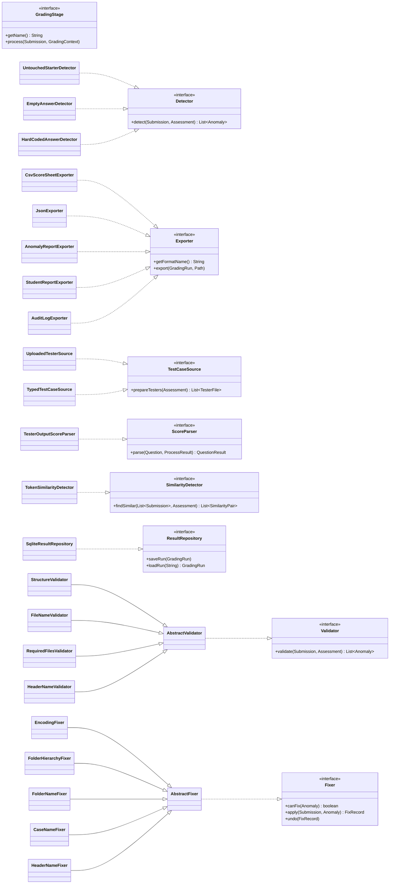
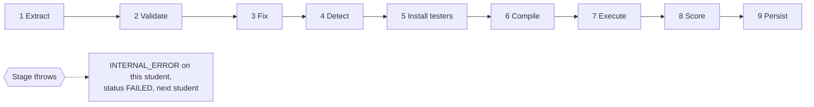
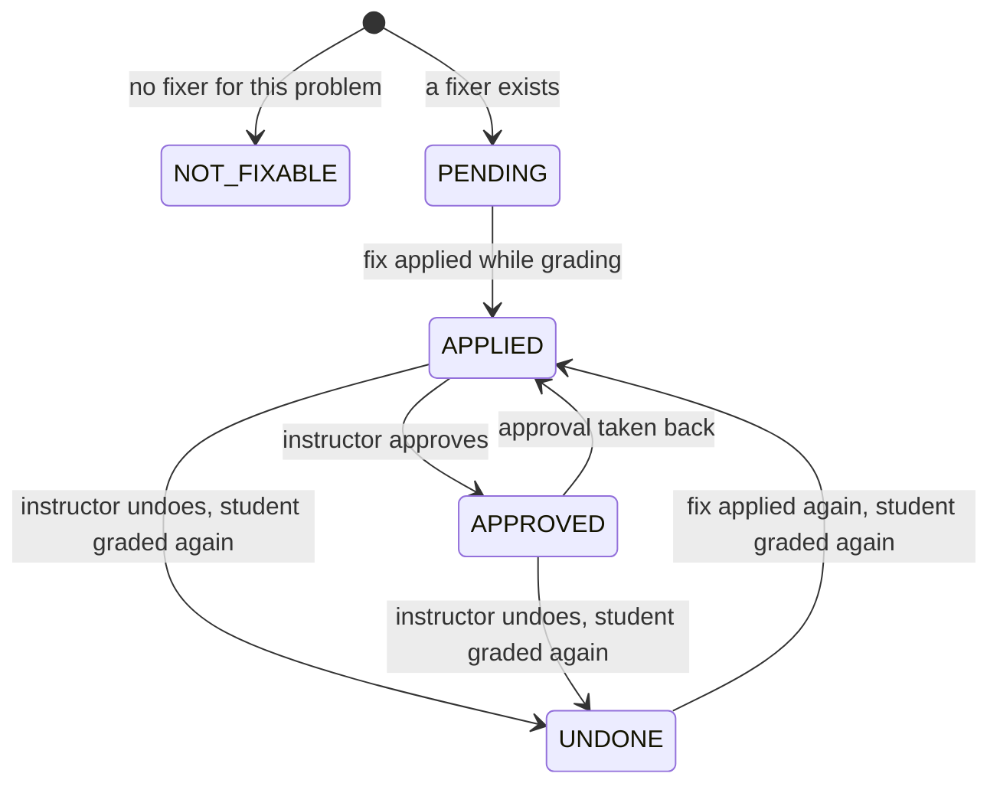
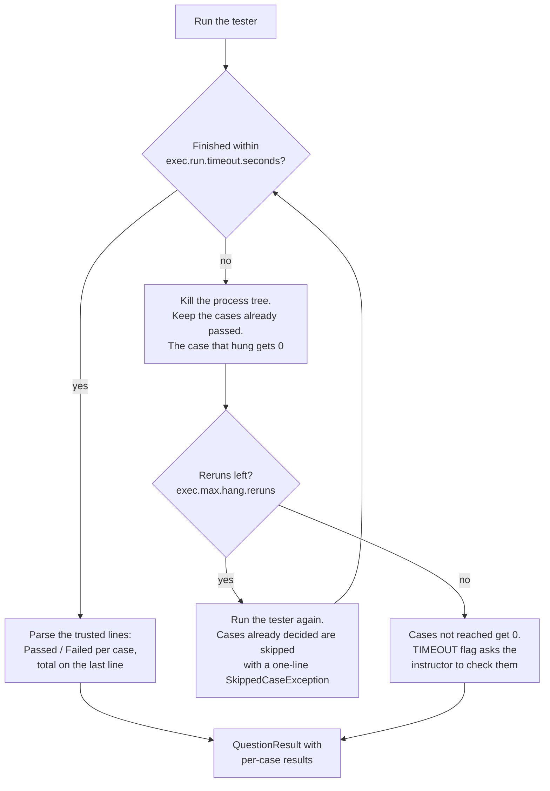
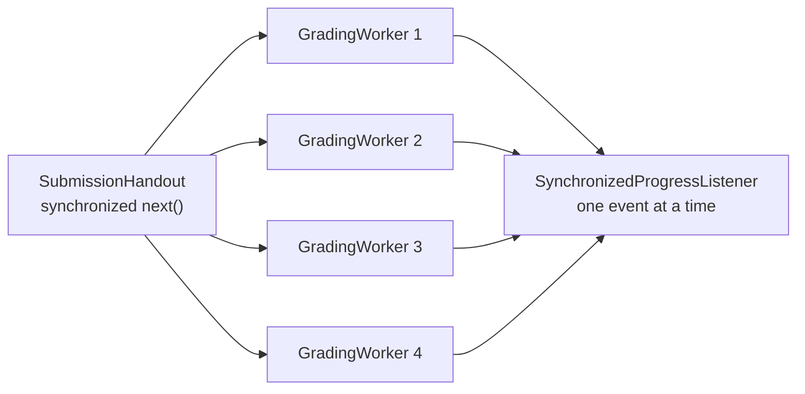
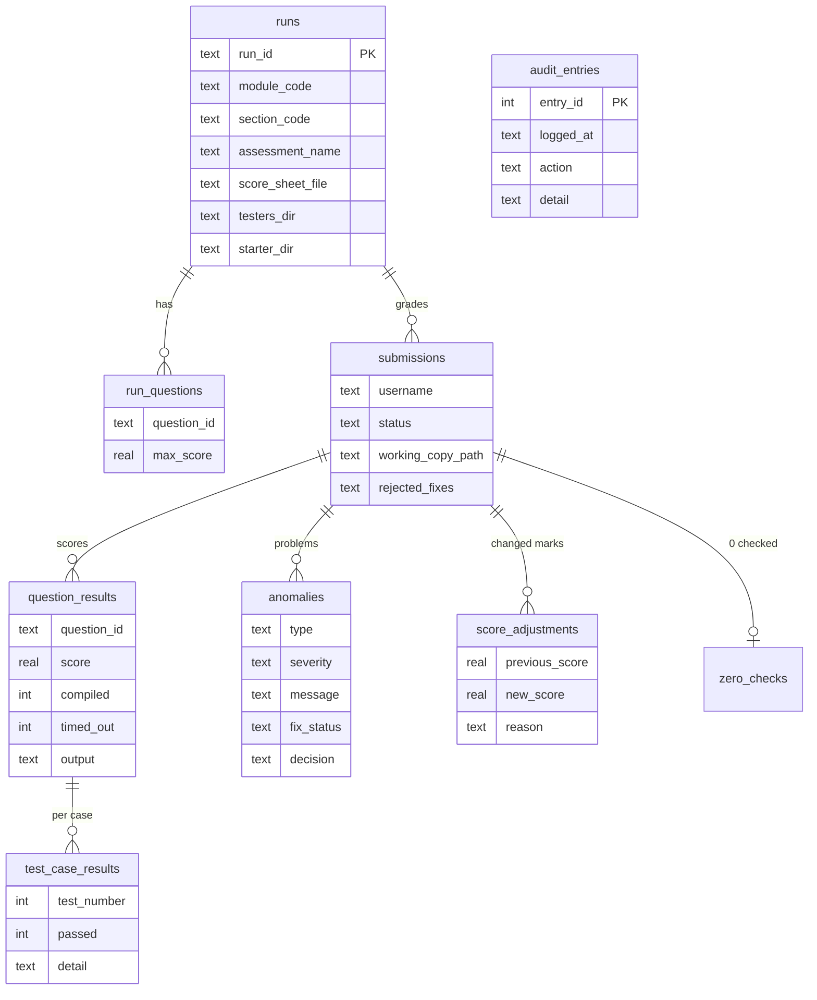

# GradeZZY

An Auto Grading System for Java lab tests, built for CS102 at Singapore
Management University. An instructor gives it a section's submission
zips, the tester files and the score sheet. GradeZZY checks and repairs
every submission, compiles and runs it against the testers with a time
limit, works out the marks and fills in the score sheet.

This README explains the **grading backend**: everything that runs
without the window. The JavaFX window is a thin layer on top of it, and
the console entry point (`sh run.sh console`) drives exactly the same
backend. Build details for each platform, the window's packages, each
teammate's part and the coding rules are in `design/TEAM-GUIDE.md`.

## Contents

- [Build and run](#build-and-run)
- [What the backend does](#what-the-backend-does)
- [Architecture](#architecture)
- [One grading run, start to finish](#one-grading-run-start-to-finish)
- [The nine pipeline stages](#the-nine-pipeline-stages)
- [Grading several submissions at once](#grading-several-submissions-at-once)
- [Problems the backend reports](#problems-the-backend-reports)
- [After grading: review, corrections and late work](#after-grading-review-corrections-and-late-work)
- [Similar code check](#similar-code-check)
- [Exports](#exports)
- [Statistics](#statistics)
- [Saved state, backup and audit log](#saved-state-backup-and-audit-log)
- [Assessments, modules and sections](#assessments-modules-and-sections)
- [Safety and robustness](#safety-and-robustness)
- [Configuration](#configuration)
- [Libraries](#libraries)
- [How the backend was tested](#how-the-backend-was-tested)

## Build and run

Needs JDK 25 with `java` and `javac` on the PATH. Every library is in
`lib/`. Run from the `GradeZZY` folder; on Windows use the `.bat` twin of
each script (`compile.bat`, `run.bat`, `clean.bat`).

```sh
sh compile.sh            # compile everything into classes/
sh compile.sh core       # compile only the backend, with no JavaFX
sh run.sh console        # grade paths.submissions.dir from the terminal
sh run.sh console G2     # the same, for section G2
sh run.sh console CS102 G2   # the same, for module CS102, section G2
sh run.sh                # open the window
sh clean.sh              # empty classes/ and remove workspace/
```

`compile.sh core` builds every package except `ui`. It proves the
backend has no dependency on the window. It empties `classes/` first, so
run `sh compile.sh` again before opening the window.

## What the backend does

Each requirement of the brief (section 4.1), and where it lives:

| Requirement | How GradeZZY meets it | Main classes |
|---|---|---|
| Batch grading | One call grades every chosen zip, folder or bulk zip, several at a time | `GradingService`, `GradingPipeline` |
| Validate structure, names and required files | Four validators, each returning problems and never throwing | `validation.*` |
| Report anomalies without stopping | Any stage failure becomes an `INTERNAL_ERROR` on that student only; the batch goes on | `GradingPipeline` |
| Correct common errors | Five fixers repair a working copy; each fix can be approved or undone | `fix.*` |
| Stop programs that run too long | Every tester runs in its own process, killed with its child processes at the limit; hung cases are skipped and the tester is run again | `ProcessRunner`, `ExecuteStage` |
| Per-question and per-student scores | Parsed from the tester's own trusted output lines | `TesterOutputScoreParser`, `ScoreCalculator` |
| Export in the provided CSV format | The score sheet is copied byte for byte with only the numerator filled in | `CsvScoreSheetExporter` |

On top of that, the backend also:

- flags untouched starter files, empty answers and hard-coded answers
  for review, without changing a mark;
- finds pairs of students with very similar code;
- reads each question's maximum mark from its tester file;
- generates tester files from test cases typed into the app;
- checks that the score sheet, testers and starter files belong with
  the uploads, and suggests a better file nearby when they do not;
- saves every run to SQLite, so a run can be resumed, retried and
  reviewed after a restart;
- adds a late batch to a section's earlier run;
- lets the instructor change a mark by hand, with a reason, and undo it;
- keeps an audit log of instructor actions;
- writes JSON, a problem report, per-student reports and the audit log;
- works out statistics per module and section;
- keeps several assessments and switches between them.

## Architecture

### Layers


Rules the code keeps:

- **The window holds no grading logic.** Screens call one interface,
  `ui.backend.DashboardBackend`. Its live version passes each call to
  one service method. Every `javafx` import is inside `ui`;
  `compile.sh core` would fail otherwise.
- **One failing submission never stops the batch.** A student's problem
  becomes an anomaly. A stage throws `GradingException` only when the
  stage itself cannot go on, and the pipeline turns that into an
  `INTERNAL_ERROR` on that student alone.
- **Originals are never modified.** Every fix and every tester run
  happens in a working copy under `workspace/working/`.
- **Every setting is external.** `config.properties` is read through
  `AppConfig`, using the names in `ConfigKeys`. Nothing is hard-coded.
- **Storage sits behind an interface.** Only `persistence` contains SQL
  or imports `java.sql`. `SqliteResultRepository` owns the connection
  and every transaction; the package-private table classes beside it
  hold the SQL.

### Packages

| Package | Responsibility | Main classes |
|---|---|---|
| `app` | Entry point and wiring. | `ConsoleMain`, `ApplicationContext`, `ConsoleProgressListener` |
| `config` | Loads and checks `config.properties`; per-module sections and export folders. | `AppConfig`, `ConfigKeys`, `ModuleSections`, `ExportFolders` |
| `model` | Plain data with no logic. | `Submission`, `Student`, `Section`, `Assessment`, `Question`, `QuestionResult`, `TestCaseResult`, `Anomaly`, `GradingRun`, `AuditEntry`, `ScoreAdjustment`, `SavedAssessment`, enums `AnomalyType`, `Severity`, `FixStatus`, `SubmissionStatus` |
| `ingest` | Turns uploads into submissions, unzips them safely, reads the roster. | `SubmissionLoader`, `ZipExtractor`, `WorkingCopyManager`, `RosterReader` |
| `validation` | One class per structural check. | `Validator`, `AbstractValidator`, `StructureValidator`, `FileNameValidator`, `RequiredFilesValidator`, `HeaderNameValidator`, `ValidationRunner` |
| `fix` | One class per automatic correction, each with apply and undo. | `Fixer`, `AbstractFixer`, `EncodingFixer`, `FolderHierarchyFixer`, `FolderNameFixer`, `CaseNameFixer`, `HeaderNameFixer`, `FixManager`, `FixRecord` |
| `detection` | Flags suspicious answers. Never changes a mark. | `Detector`, `UntouchedStarterDetector`, `EmptyAnswerDetector`, `HardCodedAnswerDetector` |
| `testcase` | Where testers come from, their maximum marks, and the per-question folders. | `TestCaseSource`, `UploadedTesterSource`, `TypedTestCaseSource`, `TesterGenerator`, `TesterInstaller`, `TesterMarks`, `QuestionWorkspace`, `FolderSnapshot` |
| `exec` | Runs `javac` and `java` as separate processes with limits. | `ProcessRunner`, `SourceCompiler`, `TesterRunner`, `TesterHarness`, `TrustedPrintStream`, `RunningProcesses`, `HarnessWatchdog` |
| `grading` | The pipeline, its stages, scoring and parallel workers. | `GradingPipeline`, `GradingStage`, the nine `...Stage` classes, `ScoreParser`, `TesterOutputScoreParser`, `ScoreCalculator`, `GradingWorker`, `SubmissionHandout`, `CancellationToken`, `QuestionRerunner` |
| `plagiarism` | Compares students' code. | `SimilarityDetector`, `TokenSimilarityDetector`, `SimilarityPair`, `LineComparison`, `LineKind` |
| `report` | One class per export format. | `Exporter`, `CsvScoreSheetExporter`, `JsonExporter`, `JsonWriter`, `AnomalyReportExporter`, `StudentReportExporter`, `AuditLogExporter` |
| `stats` | Statistics over runs. | `StatisticsCalculator`, `StatisticsSummary`, `StatisticsFilter`, `MarkBand` |
| `persistence` | Saves, loads and backs up grading state. | `ResultRepository`, `SqliteResultRepository`, `SqliteSchema`, `RunTables`, `SubmissionTables`, `ReviewTables`, `AdjustmentTable`, `AuditTable`, `JdbcSupport`, `BackupManager` |
| `service` | Everything the console and the window call. | `GradingService`, `PipelineFactory`, `AnomalyService`, `ExportService`, `StatisticsService`, `HistoryService`, `PlagiarismService`, `ScoreAdjustmentService`, `SettingsService`, `AuditService`, `AssessmentFactory`, `AssessmentLibrary`, `ClassFileMatcher`, `ServiceRegistry` |
| `util` | Shared helpers. | `FileUtils`, `TextUtils`, `InputValidator` |

### Extension points

Each kind of plug-in is an interface with exactly one place where
implementations are registered. Adding a check, a fix, an export format
or a stage means writing one class and adding one line.



The method lists are shortened; see each interface for the exact
signatures.

| Interface | Registered in |
|---|---|
| `GradingStage` | `PipelineFactory.createPipeline` (order matters) |
| `Validator` | `PipelineFactory.createValidationRunner` |
| `Detector` | `PipelineFactory.createDetectors` (each one can be switched off) |
| `Fixer` | `ApplicationContext.createFixManager` (run in the order added) |
| `Exporter` | `ApplicationContext.createExportService` |
| `TestCaseSource` | passed to `GradingService.startGrading` |
| `ScoreParser`, `SimilarityDetector`, `ResultRepository` | `ApplicationContext` |

## One grading run, start to finish


`GradingService.startGrading` refuses to start, with a message, only
when the whole batch cannot be graded: grading is already running, the
module or section is not in the settings, the score sheet, uploads or
testers cannot be read, or a tester's maximum mark cannot be counted.
A problem with one student never stops it.

## The nine pipeline stages



| # | Stage | What it does | Problems it can add |
|---|---|---|---|
| 1 | `ExtractStage` | Unzips into a working copy and matches the student on the roster. | `INVALID_ARCHIVE`, `UNKNOWN_STUDENT` |
| 2 | `ValidateStage` | Runs every validator. | `MISSING_WRAPPER_FOLDER`, `WRONG_FOLDER_NAME`, `MISSING_QUESTION_FOLDER`, `MISSING_FILE`, `WRONG_FILE_NAME`, `MISSING_HEADER_NAME` |
| 3 | `FixStage` | Checks encodings, applies fixes, then validates again. | `WRONG_ENCODING` |
| 4 | `DetectStage` | Runs every detector that is switched on. | `UNTOUCHED_STARTER`, `EMPTY_ANSWER`, `HARD_CODED_ANSWER` |
| 5 | `InstallTestersStage` | Copies testers, data files and provided class files in. | `MISSING_FILE` |
| 6 | `CompileStage` | Compiles each question in its own folder. | `COMPILE_ERROR` |
| 7 | `ExecuteStage` | Runs each tester with limits and parses its output. | `TIMEOUT`, `RUNTIME_ERROR` |
| 8 | `ScoreStage` | Caps each question at its maximum and adds up the total. | |
| 9 | `PersistStage` | Saves the student's result to SQLite. | |

A `CancellationToken` is checked between stages, so Cancel stops each
student at its next step and the run can be resumed later.

### 1. Extract: reading the uploads

`SubmissionLoader` accepts any mix of zips, folders of zips, folders
unzipped by hand and bulk zips downloaded from eLearn.

- **Username.** Taken from the zip name after removing the prefix in
  `ingest.zip.name.prefix.pattern` (so `2023-2024-ping.lee.2023.zip`
  gives `ping.lee.2023`) and any browser copy number such as ` (1)`.
- **Bulk zips.** A zip that holds student zips, and no question folder,
  is unpacked into `workspace/working/.batch-*` and each zip inside is
  one student.
- **Duplicates.** One file per username (in any letter case) is graded:
  the one without a copy number, else the lowest. The others are named
  in a `DUPLICATE_SUBMISSION` warning.
- **Skipped.** `.DS_Store`, `__MACOSX`, `Thumbs.db`, the starter folder
  itself, and files that are not zips.

`ZipExtractor` unzips with `java.util.zip` and refuses unsafe entries:
names with `..` or absolute paths (zip slip), names Windows cannot
create, more than `ingest.max.zip.entries` entries or more than
`ingest.max.zip.size.mb` unzipped. A damaged or empty zip becomes
`INVALID_ARCHIVE` for that student only. `WorkingCopyManager` removes the
student's own `.class` files, except the provided ones listed in
`assessment.provided.class.files`. `RosterReader` reads the eLearn score
sheet, removing the `#` in front of the id and username, and accepts the
same sheet re-saved by Excel (byte order mark, LF endings).

### 2. Validate: checking the structure

| Validator | Checks | Reports |
|---|---|---|
| `StructureValidator` | One top folder named after the username, holding one folder per question group. | `MISSING_WRAPPER_FOLDER`, `WRONG_FOLDER_NAME` (a starter name such as `RenameToYourUsername` is called out), `MISSING_QUESTION_FOLDER` |
| `FileNameValidator` | A file whose name matches a required name only when case is ignored (`q1a.java`). Java needs the exact name. | `WRONG_FILE_NAME` |
| `RequiredFilesValidator` | Every file in `assessment.question.<id>.file` is present. | `MISSING_FILE` |
| `HeaderNameValidator` | The first `validation.header.scan.lines` lines of each required file hold a name after `Name:` and an email after `Email ID:`. | `MISSING_HEADER_NAME` |

Each problem is reported once: a misnamed file is not also reported as
missing, and the files of a missing folder are not reported one by one.

### 3. Fix: correcting the working copy

`FixManager` offers each problem to the fixers in this order, so folders
are in place before names and headers are touched:

| Fixer | Fixes | How |
|---|---|---|
| `EncodingFixer` | `WRONG_ENCODING` | Backs the file up, removes a UTF-8 byte order mark, and rewrites a file that is not UTF-8 (read as Windows-1252) as UTF-8. |
| `FolderHierarchyFixer` | `MISSING_WRAPPER_FOLDER`, `MISSING_QUESTION_FOLDER` | Moves the question folders into a new username folder, or up out of one extra folder level. |
| `FolderNameFixer` | `WRONG_FOLDER_NAME` | Renames the only top folder to the username. |
| `CaseNameFixer` | `WRONG_FILE_NAME`, `MISSING_QUESTION_FOLDER` | Renames `q3` to `Q3` or `q1a.java` to `Q1a.java`, through a temporary name because Windows and macOS ignore case. |
| `HeaderNameFixer` | `MISSING_HEADER_NAME` | Writes the roster name and email after the blank labels, keeping the file's own encoding. |

After a fix that moved or renamed something, `FixStage` runs the file
checks again on the new layout and fixes only what is new. A fix that
cannot be made leaves the problem for the instructor, with the reason.
Setting `fix.auto.apply.enabled=false` reports problems without fixing.

Every fix is recorded in a `FixRecord` and can be undone. A file whose
content changes is first copied into the hidden `.gradezzy-backup`
folder of the working copy; a move or rename is undone by moving back.



### 4. Detect: flags for review

Detectors only add a flag. **They never change a mark.**

| Detector | Flags | Rule |
|---|---|---|
| `UntouchedStarterDetector` | `UNTOUCHED_STARTER` | A file equal to the starter file once the header comment, blank lines and line endings are ignored. If every file is untouched, one flag says the original resource folder was submitted. |
| `EmptyAnswerDetector` | `EMPTY_ANSWER` | An answer method whose body, without comments and spaces, is still the starter's body. Every overload is checked. |
| `HardCodedAnswerDetector` | `HARD_CODED_ANSWER` | A method with 3 or more `if` or `case` branches comparing a value with a fixed literal, such as `s.equals("cat")`. Common values (0, 1, -1), separators and numbers inside a calculation do not count. |

The starter folder is the one chosen for the batch, or
`paths.starter.dir`. A detector that fails adds a warning that it could
not run; it never fails the student.

### 5. Install testers

`TestCaseSource` supplies one tester per question:

- `UploadedTesterSource` matches `Q1aTester.java` and so on in the
  tester folder to the questions (`<id>` plus
  `grading.tester.class.suffix`).
- `TypedTestCaseSource` turns test cases typed in by the instructor into
  tester source with `TesterGenerator`. The generated tester extends the
  student's class and prints exactly what the provided testers print,
  one mark per case. Generated files are kept in
  `workspace/output/generated-testers`.

**Maximum marks come from the testers, not from a setting.**
`TesterMarks` adds up the `score += <number>` lines of each tester,
ignoring comments and text in quotes, which gives 3, 3, 5, 5 and 4 for
the provided testers. A tester that changes the score in a way that
cannot be counted (`score++`, `score += MARK`, `score +=` inside a loop)
stops grading with the reason, rather than giving a wrong maximum. The
total is compared with the score sheet's denominator, and a mismatch is
reported.

`TesterInstaller` copies each tester into its question folder, with the
data files in `assessment.tester.data.files`. The student's own copies
of those data files are replaced, so an edited data file cannot change
a mark.

### 6. Compile

Each question is compiled in its own copy of its folder,
`<working copy>/.questions/<id>/` (`QuestionWorkspace`), so code run for
Q1a cannot change Q1b's tester. A question that does not compile gets
`COMPILE_ERROR` with the first compiler message and a 0, and the other
questions are still compiled and graded. A compile that misses
`exec.compile.timeout.seconds` is tried once more, because a busy
computer can slow `javac`. After a second miss the student is left for
Retry with no mark taken. `FolderSnapshot` then remembers the compiled
classes and data files of each question folder.

### 7. Execute: running the testers safely

This is the stage that keeps one bad program from blocking the batch.

**One tester, one process.** `ProcessRunner` starts `java` with
`ProcessBuilder`, reads its output in a polling loop (every 50 ms) so
the program never freezes on a full output buffer, and stops reading at
`exec.max.output.characters`. At `exec.run.timeout.seconds` it kills the
process and every child process it started. A shutdown hook
(`RunningProcesses`) kills any tester still running if GradeZZY itself
closes or crashes, and a watchdog thread inside each tester run
(`HarnessWatchdog`) ends the run on its own if GradeZZY is gone.

**Limits on student code.** Each run gets `exec.max.memory.mb` of heap,
a 2 MB thread stack and one CPU, only the core Java module
(`--limit-modules=java.base`) and no native code. On macOS the run is
also placed in `sandbox-exec`, so it can write only in its own question
folder and cannot read other students' working copies. Other systems
have no built-in sandbox, and the console says so once per run.

**Only the tester's own lines are believed.** The tester is started
inside `TesterHarness`, which receives a secret token on standard input
and replaces standard output with `TrustedPrintStream`. A line is marked
with the token only when the tester printed it with no student method
on the call stack (checked with `StackWalker`). Every other line is
prefixed as student output, and `TesterOutputScoreParser` never counts
it. A student who prints `Passed` gains nothing.

**Tampering is undone.** Before each tester run, `ExecuteStage` puts
back any compiled class or data file that changed since compiling, and
flags it, so code run for one question cannot change another's result.

**A hanging test case does not cost the cases after it.** The brief asks
for the instructor's manual routine to be automated: stop the tester,
remove the case that hangs, run the rest. `ExecuteStage` does exactly
that:



Each timeout adds a `TIMEOUT` problem saying which cases passed, which
hung and which were never reached. An exception inside a case is
printed by the tester and counted as a failed case. An error the tester
cannot catch, such as a `StackOverflowError`, ends the whole run (exit
code `TesterHarness.CRASH_EXIT_CODE`); that case is skipped and the tester
run again, like a hang, and a `RUNTIME_ERROR` says so. A student's own
`System.exit` is not run again. A run that ends early never prints the
tester's total, so its `RUNTIME_ERROR` asks the instructor to read the
output before accepting the passes.

### 8. Score and 9. Persist

`ScoreCalculator` sets each question's mark and never lets it exceed the
question's maximum; the student's total is the sum. `PersistStage` saves
the student to SQLite straight away, so a crash or Cancel loses at most
the students still being graded.

## Grading several submissions at once

`GradingPipeline` grades `exec.thread.count` submissions at the same
time, using only `Thread`, `Runnable` and `synchronized`:



Each submission has its own working copy and writes only to its own
`Submission` object, so workers never share student data. The only
shared state (the next submission to hand out, the progress listener,
`FixManager` and the repository) is guarded by `synchronized`. Each
worker calls the same `gradeOne` method as the single-threaded path, so
both give the same marks.

## Problems the backend reports

Every problem is an `Anomaly` with a type, a severity (`INFO`,
`WARNING` or `ERROR`), a message written for the instructor, a suggested
action and a fix status.

| Type | Meaning | Raised by | Fixed automatically |
|---|---|---|---|
| `MISSING_WRAPPER_FOLDER` | Question folders at the top of the zip, with no username folder | `StructureValidator` | Yes |
| `WRONG_FOLDER_NAME` | Top folder not named after the username | `StructureValidator` | Yes |
| `MISSING_QUESTION_FOLDER` | A question folder is missing | `StructureValidator` | When it is one level too deep or wrongly cased |
| `MISSING_FILE` | A required file or a tester is missing | `RequiredFilesValidator`, `TesterInstaller` | No |
| `WRONG_FILE_NAME` | File name differs only in letter case | `FileNameValidator` | Yes |
| `MISSING_HEADER_NAME` | Blank name or email in the header | `HeaderNameValidator` | Yes, from the roster |
| `WRONG_ENCODING` | Byte order mark or not UTF-8, which `javac` rejects | `FixStage` | Yes |
| `UNKNOWN_STUDENT` | Not on the score sheet | `ExtractStage` | No |
| `INVALID_ARCHIVE` | Not a readable or safe zip | `SubmissionLoader`, `ExtractStage` | No |
| `DUPLICATE_SUBMISSION` | Another upload with the same username was set aside | `SubmissionLoader` | No |
| `COMPILE_ERROR` | A question did not compile | `CompileStage` | No |
| `TIMEOUT` | A tester was stopped at the time limit | `ExecuteStage` | No |
| `RUNTIME_ERROR` | A tester ended with an error | `ExecuteStage` | No |
| `UNTOUCHED_STARTER` | A file equals the starter file | `UntouchedStarterDetector` | Flag only |
| `EMPTY_ANSWER` | A method still holds only the starter code | `EmptyAnswerDetector` | Flag only |
| `HARD_CODED_ANSWER` | An answer looks hard-coded to sample cases | `HardCodedAnswerDetector` | Flag only |
| `SIMILAR_CODE` | Code very similar to another student's | `PlagiarismService` | Flag only |
| `INTERNAL_ERROR` | GradeZZY itself failed on this student | `GradingPipeline` and the stages | No |

For example, on the six provided samples the console reports:

```text
[3/6] chee.teo.2022: GRADED, total 12.0, 3 problem(s)
       MISSING_WRAPPER_FOLDER: The question folders were at the top of the
       ZIP file instead of inside a chee.teo.2022 folder.
       MISSING_HEADER_NAME: Q3/Q3.java has no name after Name: and no
       email after Email ID: in its header.
       UNTOUCHED_STARTER: Q3/Q3.java is unchanged from the starter file.
```

## After grading: review, corrections and late work

| Action | Method | What happens |
|---|---|---|
| Approve a fix | `AnomalyService.approveFix`, `approveAll` | The fix is kept and marked `APPROVED`. |
| Undo a fix | `AnomalyService.undoFix`, `undoAll` | The working copy is put back and the student is graded again without the fix, so the mark matches the files as submitted. The undone fix is remembered, so Retry and Resume skip it too, even after a restart. |
| Apply a fix again | `AnomalyService.reapplyFix` | The fix is made again and the student regraded. |
| Record a review decision | `AnomalyService.saveDecision`, `saveZeroCheck` | Saved with the run, so it is there after a restart. |
| Change a mark | `ScoreAdjustmentService.adjust`, `undo` | A mark from 0 to the question's maximum, with a required reason. Saved, shown in exports and the audit log. Only the newest change of a question can be undone. |
| Run one question again | `QuestionRerunner` | Runs one tester for one student to look at the output; the saved marks do not change. |
| Grade one student again | `GradingService.regradeSubmission` | Runs the pipeline for that student and replaces the result. |
| Cancel | `GradingService.cancel` | Each student stops at its next stage; finished students are saved. |
| Retry failed | `GradingService.retryFailed` | Grades only the students that failed or were not finished. |
| Resume | `GradingService.resume` | Loads a saved run, with its own score sheet, tester and starter folders, and grades what is left. |
| Late batch | `GradingService.findNewestRun`, `addToRun` | Adds students to the section's earlier run. A student graded before is graded again and the old total is kept in the audit log. Refused when the tester folder or score sheet is not the run's. |
| Change score sheet | `GradingService.changeScoreSheet` | Matches the students to another sheet and saves the run, without grading again. |

## Similar code check

`TokenSimilarityDetector` compares every pair of students, one question
at a time:

1. Each answer is split into tokens, ignoring spacing and comments.
2. Every run of three tokens (a trigram) is collected.
3. The starter file's trigrams are removed, so the shared skeleton does
   not count.
4. Two answers are compared with the Jaccard measure: shared trigrams
   divided by all trigrams.
5. Pairs at or above `plagiarism.similarity.threshold` (0.80) get a
   `SIMILAR_CODE` flag on both students.

A pair is compared only when both answers have at least 50 trigrams of
their own, because short correct answers look alike even when written
separately. Renaming variables or reordering code lowers the score; this
is a basic check that points the instructor at pairs to read, not
proof. It runs after grading when `plagiarism.enabled` is true, and the
window's Export step can run it on demand.

"Compare" on a similar pair opens both answer files side by side, in one
box that scrolls as one. `LineComparison` marks each line, ignoring
spaces: red when the same line is in the other student's file, grey with
a "starter" tag when it is in the starter file (starter code is never
red), and plain when it is the student's own. A line holding only
brackets, such as `}`, takes the colour of the line above it. Each side
shows how many of its own lines are the same, and "Next same part" and
"Previous" jump between the red blocks of the first student's file. The
lines only help the instructor read a pair; the percentage still comes
from the trigrams above, so a renamed variable makes a line plain even
though the score may stay high.

## Exports

`ExportService` finds an `Exporter` by name and writes to the output
folder of the section (`paths.output.dir.by.section`, else
`paths.output.dir`).

| Format | Class | Contents |
|---|---|---|
| Score sheet CSV | `CsvScoreSheetExporter` | The provided score sheet, unchanged except for `Calculated Final Grade Numerator`. Columns, `#` prefixes, the `#` end marker, quotes, the encoding (UTF-8 with or without a byte order mark, or Windows-1252) and the CRLF line endings stay as they were. |
| JSON | `JsonExporter`, `JsonWriter` | Every student, question, test case and problem, written by hand without a library. |
| Problem report | `AnomalyReportExporter` | One row per problem, with its fix status. |
| Student reports | `StudentReportExporter` | A readable report per student: marks per question, test cases and problems. |
| Audit log | `AuditLogExporter` | Every logged instructor action. |

`ExportService.summarizeScoreSheet` can list which students get a mark,
which are on the sheet with no submission, which were not graded, and
which graded students are not on the sheet. Nothing calls it yet: the
Export step does not show this summary, so blank numerators in the CSV
are not reported.

## Statistics

`StatisticsService` filters runs by module and section (newest run per
section) and `StatisticsCalculator` works out:

- mean, median and pass rate (`stats.pass.mark.percent`);
- mark bands of `stats.mark.band.width.percent`;
- pass rate per question;
- the test case failed most often;
- the most common compile errors.

## Saved state, backup and audit log

With `database.enabled=true`, every run is saved to the SQLite file
`database.file` through JDBC. Every save is one transaction, so a run is
never left half written, and every query uses `PreparedStatement` with
`?` placeholders.



- **History.** `HistoryService.listRuns` reads every saved run back, so
  earlier runs can be reviewed, exported and resumed after a restart.
- **Backup and restore.** `BackupManager` copies the database file to
  `paths.backup.dir`, keeping the newest `database.backup.keep.count`,
  and restores one after closing the database.
- **Audit log.** With `audit.enabled=true`, `AuditService` records
  grading started, cancelled, retried and resumed, fixes approved and
  undone, marks changed, settings saved, backups made and restored, and
  exports.

A failed save never loses the results held in memory; the problem is
reported and grading goes on.

## Assessments, modules and sections

- **Questions are configuration.** `AssessmentFactory` builds the
  `Assessment` from `assessment.question.ids` and each question's folder
  and file, with maximum marks read from the testers. A different lab
  test needs new settings and testers, not new code.
- **Several assessments.** `AssessmentLibrary` saves each assessment as a
  `.properties` file in `paths.assessments.dir`. Using one copies its
  questions, tester folder and starter folder into the active settings.
  `AssessmentFolderScanner` reads data files, provided class files and
  question folders from a tester or starter folder to fill one in.
- **Modules and sections.** `app.module.codes` lists the modules and
  `app.section.codes` the sections; a module can have its own sections.
  The instructor picks the section for each batch, because no provided
  file names it. A run checks that the section belongs to the module.
- **Choosing the right files.** `ClassFileMatcher` checks that the
  chosen score sheet lists most of the uploads, and that the testers and
  starter files use the methods the students' files declare (such as
  `getIsogramWords` in `Q1a.java`). When one does not fit, it looks in
  nearby folders for one that does and suggests it. It only warns;
  grading can still start.

## Safety and robustness

| Risk | Guard |
|---|---|
| One student crashes the grader | Each stage failure becomes an `INTERNAL_ERROR` on that student; the batch carries on. |
| Infinite loop or very slow code | Per-run time limit, kill of the whole process tree, rerun without the hung case. |
| An error the tester cannot catch (`StackOverflowError`, `OutOfMemoryError`) | Rerun without the case that crashed, so the cases after it are still marked. |
| Endless printing | Output capped; student output has its own smaller share so the tester's lines are never cut off. |
| Huge memory use or deep recursion | Heap limit, 2 MB stack, one CPU per run. |
| Student prints `Passed` | Only token-marked lines from the tester are counted. |
| Student code edits other files | Per-question folders, restore of changed class files, macOS sandbox. |
| Zip slip or zip bomb | Entry names checked; entry count and unzipped size capped. |
| Damaged, empty or duplicate uploads | Reported per student; duplicates set aside with a warning. |
| Wrong tester, sheet or starter folder | Maximum marks checked before grading; `ClassFileMatcher` warns and suggests a better file. |
| GradeZZY is closed mid-run | Shutdown hook kills testers; each student is saved as it finishes; Resume continues. |
| Bad settings | Every setting is validated at start-up, and the message names each bad one. |
| Original uploads changed | Never: all work happens in working copies. |

## Configuration

Every setting is in `config.properties` and is read through
`AppConfig`, using the names in `ConfigKeys`. A missing setting stops the
application at start-up with a message naming the setting. So does a value
that is not valid (for example `database.enabled=yes`): every setting is
checked once with `SettingsService.validate`, and the message names all
the bad ones. The folders and the score sheet that must already exist are
left out of that check, because Set up chooses them again for each batch.
To use another file: `java -Dgradezzy.config=other.properties ...`.

| Setting | Default | What it does |
|---|---|---|
| `app.module.codes` | `CS102` | Modules the instructor can pick from, separated by commas. The first is the default. |
| `app.section.codes` | `G1,G2,...,G10` | Sections every module has. At least one is needed, so Settings does not let the last one be deleted. |
| `app.section.codes.by.module` | empty | Sections of one module only, such as `CS102:G5\|G6;IS442:G1`. Written when a section is added for one module only. Read through `config.ModuleSections`. |
| `app.module.codes.own.sections.only` | empty | Modules that do not get the sections every module has, only their own, separated by commas. A module added in the window is listed here. Grading checks that the section belongs to the module. |
| `paths.submissions.dir` | `samples/student-submission` | Folder graded by the console entry point. |
| `paths.testers.dir` | `samples/Tester-Files` | Folder holding the tester files. |
| `paths.score.sheet.file` | `samples/IS442-ScoreSheet.csv` | The roster and the template for the CSV export. |
| `paths.score.sheet.by.section` | (empty) | Each section's own score sheet, such as `CS102/G1=Test Data/G1.csv`, set in Settings. A section with none uses `paths.score.sheet.file`. A run started with no score sheet chosen (the console) and a run saved without one (Export's warning and the CSV export) all use this rule (`config.ExportFolders.findScoreSheet`). |
| `paths.starter.dir` | `samples/RenameToYourUsername` | Starter files, used to spot untouched answers when no starter folder is chosen on the Set up step, and by the similarity check. Set up warns when a chosen starter folder lacks some question files. |
| `paths.working.dir` | `workspace/working` | Where working copies are created. |
| `paths.output.dir` | `workspace/output` | Where exports are written. |
| `paths.output.dir.by.section` | empty | Export folders of single modules or sections, such as `CS102/G1=workspace/g1-exports;IS442=workspace/is442`. A section's own folder wins over its module's, then `paths.output.dir`. Deleting a module or section removes its entries here and in `paths.score.sheet.by.section`. |
| `paths.backup.dir` | `workspace/backup` | Where database backups are kept. |
| `paths.assessments.dir` | `workspace/assessments` | Where saved assessments are kept, one `.properties` file each. Choosing one on Home or Set up copies its `assessment.*`, `paths.testers.dir` and `paths.starter.dir` settings into `config.properties`. |
| `ingest.zip.name.prefix.pattern` | `^[0-9]{4}-[0-9]{4}-` | Text in front of the username in a zip file name. |
| `ingest.ignored.file.names` | `.DS_Store,__MACOSX,Thumbs.db` | Names skipped inside a submission. |
| `ingest.max.zip.size.mb` | `50` | Largest unzipped size accepted. |
| `ingest.max.zip.entries` | `2000` | Largest number of entries accepted in a zip. |
| `assessment.name` | `Lab Test` | Name of the assessment in use. Create, edit and switch assessments in the window (Home, Manage assessments) rather than here. |
| `assessment.question.ids` | `Q1a,Q1b,Q2a,Q2b,Q3` | The questions, in order. |
| `assessment.question.<id>.folder` | for example `Q1` | Folder the question's file must be in. |
| `assessment.question.<id>.file` | for example `Q1a.java` | The required source file. |
| `assessment.placeholder.folder.names` | `RenameToYourUsername,RenameToYourStudentID` | Folder names that mean the student forgot to rename. |
| `assessment.provided.class.files` | `DataException.class`, ... | Compiled files that are kept in the working copy. |
| `assessment.tester.data.files` | `personstester.txt,studentstester.txt` | Data files copied next to the testers. |
| `validation.header.name.label` | `Name:` | Label in front of the name in a file header. |
| `validation.header.email.label` | `Email ID:` | Label in front of the email in a file header. |
| `validation.header.scan.lines` | `10` | Lines at the top of a file searched for the header. |
| `fix.auto.apply.enabled` | `true` | Apply fixes automatically, or only report. |
| `exec.javac.command` | `javac` | Command used to compile. |
| `exec.java.command` | `java` | Command used to run a tester. |
| `exec.compile.timeout.seconds` | `30` | Time limit for compiling one question folder. A compile that misses it is run once more, because a busy computer can slow `javac`; after the second miss the student is left for Retry, with no mark taken. |
| `exec.run.timeout.seconds` | `10` | Time limit for one tester run. |
| `exec.thread.count` | `4` | Submissions graded at the same time. |
| `exec.max.output.characters` | `100000` | Longest program output kept. In a tester run, student prints may use half of it, so the tester's own lines are never cut off. When a tester is run again after a hang, the runs share this limit: the last run is kept whole and the earlier ones keep their ends. |
| `exec.max.memory.mb` | `256` | Most memory, in MB, one tester run may use for its objects. `0` means no limit. Each run also gets a 2 MB thread stack and one CPU. A whole number of 0 or more; GradeZZY does not start with any other value. |
| `exec.max.hang.reruns` | `2` | Times a question's tester is run again, without the case that hung or crashed, so the cases after it are still marked. Each rerun can take the whole time limit. After the last one, the cases not yet run get no mark and the timeout flag asks the instructor to check them. A whole number of 0 or more; GradeZZY does not start with any other value. |
| `grading.tester.class.suffix` | `Tester` | `Q1a` becomes `Q1aTester`. |
| `grading.pass.marker` | `Passed` | Line a tester prints for a passed test. |
| `grading.fail.marker` | `Failed` | Start of the line for a failed test. |
| `grading.test.header.marker` | `Test` | Start of the line a tester prints before each test, such as `Test 1: ...`. |
| `detection.untouched.enabled` | `true` | Flag untouched starter files. |
| `detection.empty.enabled` | `true` | Flag empty answers. |
| `detection.hardcoded.enabled` | `true` | Flag hard-coded answers. |
| `plagiarism.enabled` | `true` | Run the similarity check after grading. `GradingService` runs it when a batch, a retry, a resume, a regrade (such as after Undo) or a late batch has been graded, in the console and the window alike; the console prints the similar pairs after its summary. |
| `plagiarism.similarity.threshold` | `0.80` | Similarity at which a pair is flagged. |
| `export.formats` | `csv,json` | Formats offered by default. |
| `export.csv.line.ending` | `CRLF` | Line ending of the score sheet. |
| `export.csv.id.prefix` | `#` | Character in front of the id and username. |
| `export.csv.end.of.line.marker` | `#` | Value of the last column. |
| `stats.pass.mark.percent` | `50` | Percentage that counts as a pass. |
| `stats.mark.band.width.percent` | `10` | Width of each mark band. |
| `database.enabled` | `true` | Save grading state to SQLite. |
| `database.file` | `workspace/gradezzy.db` | Location of the database file. |
| `database.backup.keep.count` | `5` | Backups kept before the oldest is deleted. |
| `audit.enabled` | `true` | Log instructor actions. |
| `ui.theme` | `light` | Theme of the window: `light` or `dark`. |
| `ui.window.width`, `ui.window.height` | `1200`, `800` | Starting window size. |
| `ui.animations.enabled` | `true` | Show subtle animations. |

The time limits, size limits, pass mark, band width and similarity
threshold are starting values chosen by the team. They do not come from
the brief.

## Libraries

The backend uses one library:

| Library | Version | Licence | Why |
|---|---|---|---|
| SQLite JDBC (`sqlite-jdbc`) | 3.53.4.0 | Apache 2.0 | A database in one file with no server to install, for saved runs, history, resume and backup. |

Everything else is the JDK. JSON is written by the hand-written
`JsonWriter`, so there is no JSON library, and there is no Excel export.
The window's libraries (JavaFX, AtlantaFX, ControlsFX) and the Java used
beyond the CS102 syllabus are listed in `design/TEAM-GUIDE.md`.

## How the backend was tested

- **The six provided samples.** `sh run.sh console G2` gives these
  totals, the same as the totals in `samples/groundtruth.txt`:

  | Student | Total | Problems reported |
  |---|---|---|
  | chee.teo.2022 | 12 | missing username folder, blank header, untouched Q3 |
  | david.2024 | 10 | folder named `01400003`, blank header, untouched Q3 |
  | fen.lai.2022 | 10 | folder left as `RenameToYourStudentID`, Q3 compile error |
  | jing.lim.2021 | 0 | missing username folder, five blank headers, compile errors |
  | ping.lee.2023 | 20 | none |
  | xing.yan.2023 | 1 | untouched files, empty answer, Q2a timeout |

  The ground truth's question marks for xing.yan.2023 add up to 15,
  although its total line reads 1.0. Here its Q2a tester hangs on test
  2, also with a 60 s limit, and GradeZZY reports a `TIMEOUT` naming
  the cases it kept and the ones it could not mark.
- **A full section of edge cases.** `samples/e2e/` holds 42 students for
  section G4 with duplicate, renamed, nested, damaged, re-encoded, late,
  copied and hard-coded uploads, two uploads from people not on the
  sheet, and a score sheet re-saved by Excel. `make_e2e.py` rebuilds it
  and its `README.md` lists the expected marks.
- **Compile checks.** `sh compile.sh core` and `sh compile.sh` finish
  with no error or warning.
